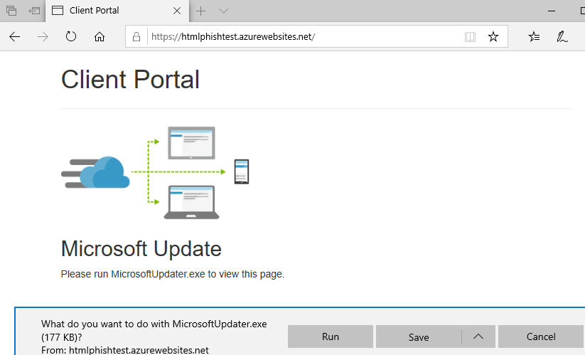
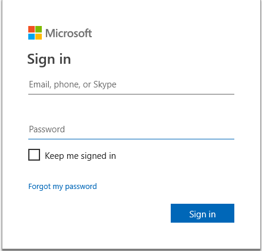
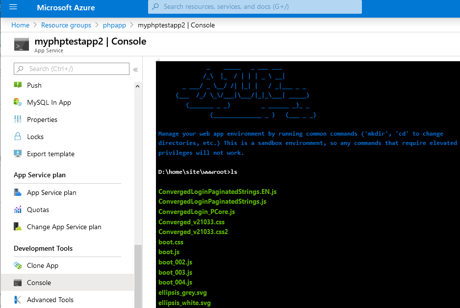
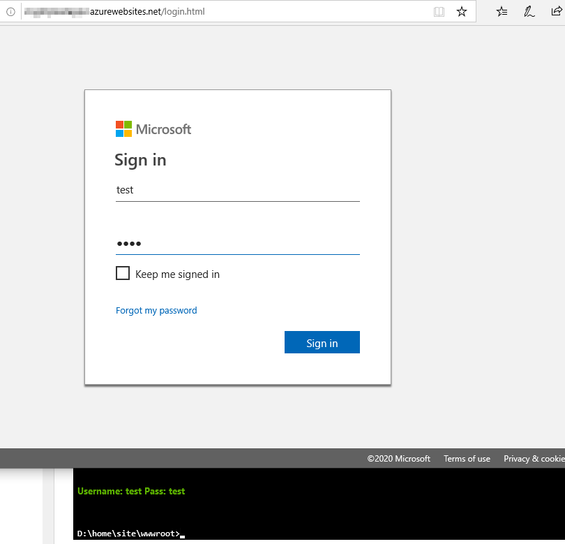
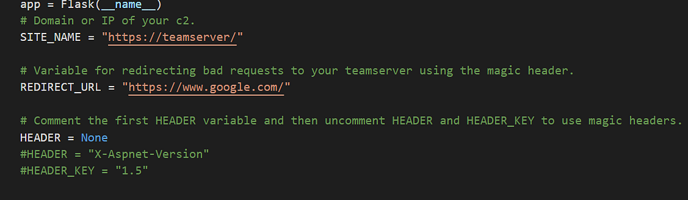
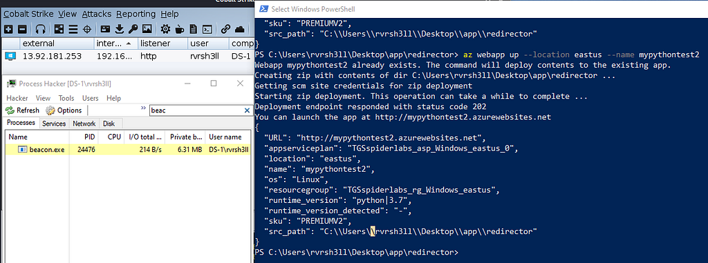
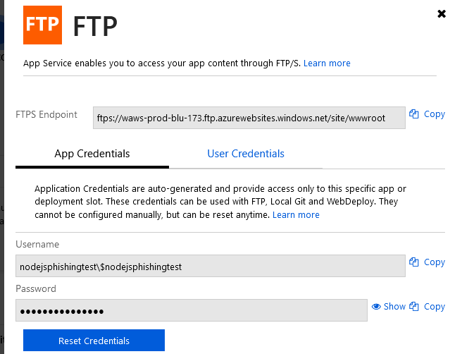

In this blog, I will be covering how to use Azure App Services for offensive purposes.

What are Azure App Services you may ask?

Azure App Services as defined by Microsoft:

“Quickly build, deploy, and scale web apps created with popular frameworks .NET, .NET Core, Node.js, Java, PHP, Ruby, or Python, in containers or running on any operating system. Meet rigorous, enterprise-grade performance, security, and compliance requirements by using the fully managed platform for your operational and monitoring tasks.” — <https://azure.microsoft.com/en-us/services/app-service/>

What’s great beyond the ability to run many platforms such as .NET, Python, and Node.js, is that when you deploy an app, you receive a custom subdomain on “.azurewebsites.net”. Pretty nice! Deploying websites and applications is also a breeze with the Azure PowerShell modules.

What can we do with Azure Apps regarding offensive operations?

· Static HTML Pages

· PHP Phishing Pages

· C2 Redirection via Flask

Microsoft Examples:

Static HTML

<https://github.com/Azure-Samples/html-docs-hello-world>

NodeJS

<https://github.com/Azure-Samples/nodejs-docs-hello-world>

Python

<https://github.com/Azure-Samples/python-docs-hello-world>

**Prerequisites:**

· Azure PowerShell modules <https://docs.microsoft.com/en-us/powershell/azure/install-az-ps?view=azps-3.8.0>

· Git

**Azure PowerShell static HTML deployment**

First, log into your Azure service with the az login command.

For help on all commands available use az webapp up help

For a static html deployment, start in your web application’s root folder and simply deploy your app with “az webapp up --location eastus --resource-group htmlphishtest --name htmlphishtest --html”

Note that when your deployment is finished, you’ll have a domain “htmlphishtest.azurewebsites.net”!

In this simple example where I am using a modified version of the “html-docs-hello-world” page which will serve up an executable to the target.

Here is what it looks like when browsed to:

Static Phishing Page with JavaScript Downloader

**PHP Credential Phishing**

Using PHP applications from the zphisher platform, <https://github.com/htr-tech/zphisher> we can serve up credential harvesting pages via Azure Apps as well. This takes a little more effort and requires that Git be installed.

For the Microsoft docs regarding this deployment, visit <https://docs.microsoft.com/en-us/azure/app-service/app-service-web-get-started-php>.

First, create your deployment user and password. These credentials will be used to clone and push the Git repository you deploy.

az webapp deployment user set --user-name <username> --password <password>

Next, create a resource group.

az group create --name myResourceGroup --location eastus

Create an Azure App Service plan.

az appservice plan create --name myAppServicePlan --resource-group myResourceGroup --sku FREE

Create your empty web application.

# Bash

az webapp create --resource-group myResourceGroup --plan myAppServicePlan --name <app_name> --runtime "PHP|7.4" --deployment-local-git

# PowerShell

az --% webapp create --resource-group myResourceGroup --plan myAppServicePlan --name <app_name> --runtime "PHP|7.4" --deployment-local-git

This command will output the details of your app including the git URL to clone.

From a clean folder, clone your empty git repository using the username and password you set for the application.

Example: git clone <https://myphptestapp2.scm.azurewebsites.net:443/myphptestapp2.git>

Copy your PHP phishing application into the empty folder. In this instance I used the “Microsoft” folder from zphisher.

Add your files with git.

git add *

Commit your changes.

git commit -a -m "Initial Commit"

Push your repo to your application.

git push

Your phishing application should now be hosted at your azurewebsites.net URL.

Fake Login Page

Now, to access the logs, open a console via the application’s console page located in your Azure Portal.

Accessing the Console

In this instance, cat the usernames.txt file for any captured credentials.

Viewing Captured Credentials

**Flask C2 Redirection**

Using a Python Flask app, allows you to also perform redirection to a Command and Control (C2) server. In this example, I am using a “magic header” as described in my previous blog about protecting redirectors.

In Cobalt Strike, this magic header may be set under the “client” portion of your profile. Also, be sure to comment the first HEADER variable and then uncomment HEADER and HEADER_KEY to use magic headers in application.py.

application.py settings

From the Python-Flask-Redirector folder execute the following command with your custom variables.

az webapp up --location eastus --resource-group mynewresourcegroup --name mynewsubdomain --SKU FREE

After launching a beacon, the redirector checks that the magic header exists or else it will redirect to a site of your choosing. Note the external ip address of this beacon running through Azure Apps. It may be good to whitelist this range.

Deploying the redirector and receiving a Cobalt Strike Beacon

If you would like to manage your app via Secure FTP, you may do so by enabling that in the Deployment Center in the settings of your App in Azure. For more information on this visit <https://docs.microsoft.com/en-us/azure/app-service/deploy-ftp>

FTPS Settings

That is all for now! Please visit my GitHub for the code used in this post at <https://github.com/rvrsh3ll/Azure-App-Tools>. I hope this blog post shed some light on how legitimate Azure services may be used for offensive purposes.
