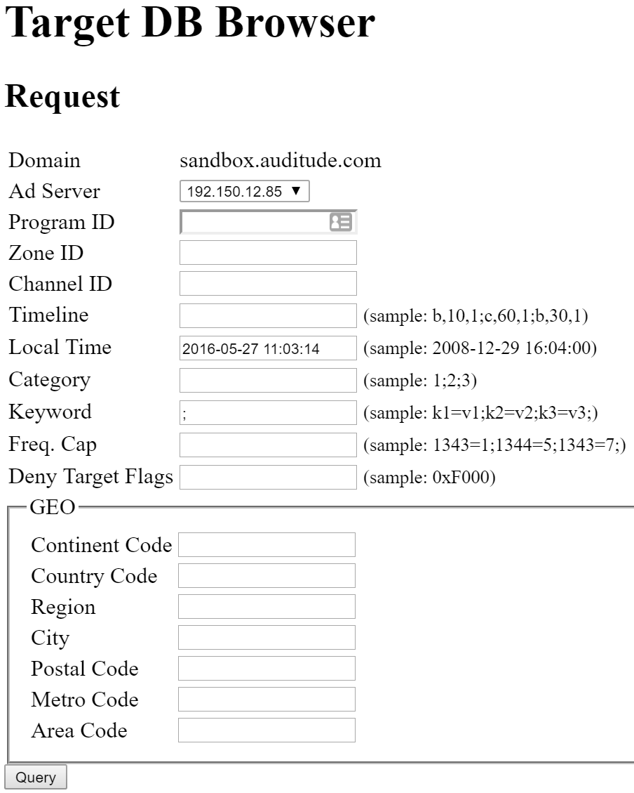
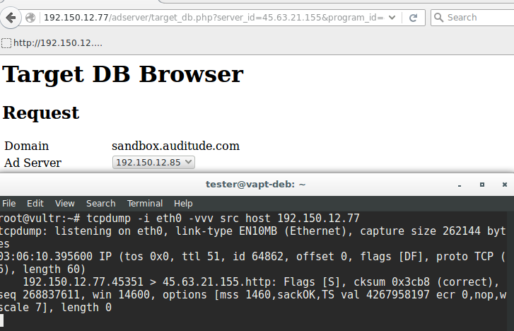

On a recent bug hunt targeting *.adobe.com, I found a small flaw in one of their external-facing web servers. While enumerating publicly available web servers belonging to Adobe, I found a web application labeled “Target DB Browser”.

This interface looked to be a front-end application to query a database. Unfortunately, every query I performed resulted in “**Error: unable to retrieve response”**. This meant that the front-end application was not actually connected to a live database. I decided to inspect the request and response a bit further by using the BurpSuite proxy tool to inspect the traffic. I found the application to be performing a simple GET request to a specified IP address. On my Virtual Private Server (VPS) , I started “tcpdump” and replaced the specified IP address in the GET request with that of my VPS address to test for the possibility of an external request. Once I clicked the “query” button, I was greeted with traffic on my VPS from the server hosting the application.

PortSwigger classifies this type of finding as “Out-of-band resource load” [here](http://blog.portswigger.net/2015/04/introducing-burp-collaborator.html).

Out-of-band resource load occurs when a payload submitted to the target application causes it to fetch content from an arbitrary external domain using some network protocol, and incorporate that content into its own response to the request that contained the payload.

An attacker may use this flaw to conduct denial of service attacks on other sites by causing the application to continuously request resources elsewhere.

While this vulnerability does not impose a major risk for Adobe, it does provide for the possibility of unintended resources being utilized on the Adobe server or for reflecting a Denial of Service attack to other addresses on the internet. Adobe has since closed this bug report. If you’re assessing web applications for work or profit, keep in mind that anytime you can replace an IP address in a request, this may be an issue to look for. Happy hacking!
