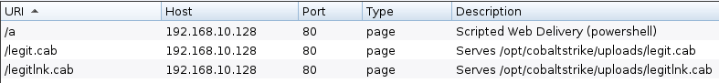
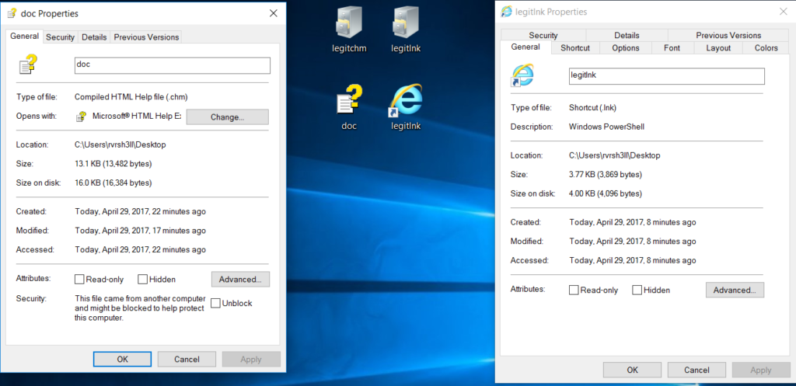
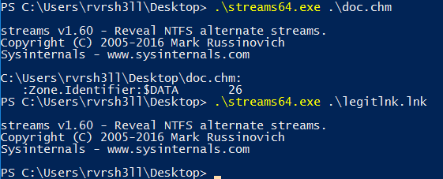
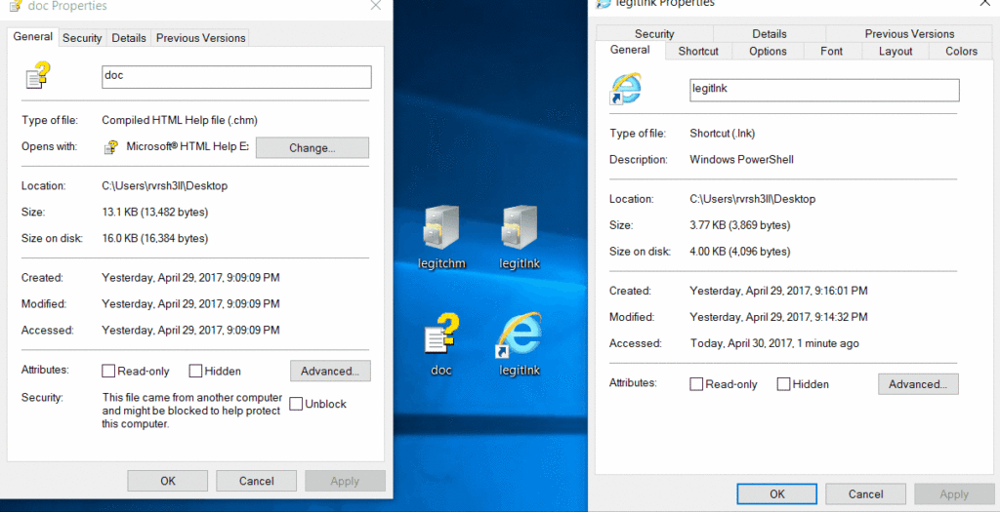

Starting with Windows XP Service Pack 2, Microsoft introduced the “Windows Attachment Manager”. This feature will “block” certain file types from being executed after downloading over the Internet. “If the attachment is in the list of high risk file types and is from the restricted zone, Windows blocks the user from accessing the file. If the file is from the Internet zone, Windows prompts the user before accessing the file.”* When a file is downloaded from the Internet and it’s one of the high-risk file types, Windows creates an alternate data stream to identify the file and apply the block. I’ll show you this more in a bit.

While this is a great safety feature for end-users, it obviously poses issues when trying to deliver certain phishing payloads on an offensive security engagement. I decided to do a little research on what types of payloads might not get blocked by the Windows Attachment Manager feature.

Starting off, I wanted to find a list of file-types that will be blocked upon download. Microsoft is nice enough to provide this list for us<https://support.microsoft.com/en-us/help/883260/information-about-the-attachment-manager-in-microsoft-windows>

The types are:

.ade,.adp,.app,.asp,.bas,.bat,.cer,.chm,.cmd,.com,.cpl,.crt,.csh,.exe,.fxp,.hlp,.hta,.inf,.ins,.isp,.its,.js,.jse,.ksh,.lnk,.mad,.maf,.mag,.mam,.maq,.mar,.mas,.mat,.mau,.mav,.maw,.mda,.mdb,.mde,.mdt,.mdw,.mdz,.msc,.msi,.msp,.mst,.ops,.pcd,.pif,.prf,.prg,.pst,.reg,.scf,.scr,.sct,.shb,.shs,.tmp,.url,.vb,.vbe,.vbs,.vsmacros,.vss,.vst,.vsw,.ws,.wsc,.wsf,.wsh

I noticed there’s a few file types that aren’t blocked and began to wonder if we can leverage those non-blocked file types to execute the blocked types.

I decided to start by using the built-in makecab.exe command to compress my payloads with the mindset of “living off the land”. For payloads, I created a malicious .LNK file using a [Create-LNK](https://gist.github.com/enigma0x3/167a213eee2e245986a5ca90bab76c6a) by @enigma0x3. I also created a malicious .CHM file using [Out-CHM](https://github.com/samratashok/nishang/blob/master/Client/Out-CHM.ps1) from the Nishang project. Both of these payloads are typically blocked after downloading by the Windows Attachment Manager. Next, I used makecab.exe to compress these payloads and hosted them on my Cobalt Strike Server.

Now that my payloads are hosted and ready for downloading. I used a Windows 10 VM and the Chrome Browser to download and uncompress each file. Right-clicking each downloaded payload and looking at properties, we can see that the .chm was still labeled as “blocked” and the .lnk was not!

Here is the difference with Alternate Data Streams (ADS) shown by the sysinternals tool streams64.exe:

If I execute each payload, the .chm should be blocked from calling back to the Cobalt Strike server while the .lnk file executes fully.

I’m not quite sure why the Windows Attachment Manager is inconsistent across different file types though. There definitely is more research to be done in this area but, I hope this post brings a little awareness for defenders and offensive testers alike.

*https://support.microsoft.com/en-us/help/883260/information-about-the-attachment-manager-in-microsoft-windows
