**Introduction**

A fundamental part of any network is the Domain Name Service (DNS). Adversaries will likely want to enumerate computers in Active Directory and connect to them, and at some point, they will likely interact with DNS doing so. A simple example is attempting to access a remote share and the resulting DNS query.

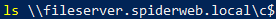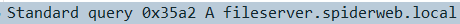

Since DNS is a critical service to internal networks and we know adversaries will use it, this provides an excellent “choke point” for detection. Since we control Active Directory and DNS, we can control what the adversary may see. We can accomplish this by placing a few Active Directory canaries and monitoring specific DNS queries.

In the early days of coal mining, miners would place a canary bird in the shaft of the mine as a detector for noxious gases. In this post, we’re going to create some active directory canaries that will aid us in detecting threat-actors enumerating our network using HELK, SilkETW, and DNS Analytical Logging.

**Getting Started**

Logging detailed DNS requests is a bit tricky and depending on the size of the organization, may require some additional storage or performance considerations. We currently have the options of either logging DNS queries at the DNS server or at the host-level. This post will cover the former while a follow-up post will cover host-level monitoring, detection and deception.

In order to obtain detailed DNS logs on the server, we’ll need to enable Windows DNS Analytical Logging. <https://blogs.technet.microsoft.com/teamdhcp/2015/11/23/network-forensics-with-windows-dns-analytical-logging/>

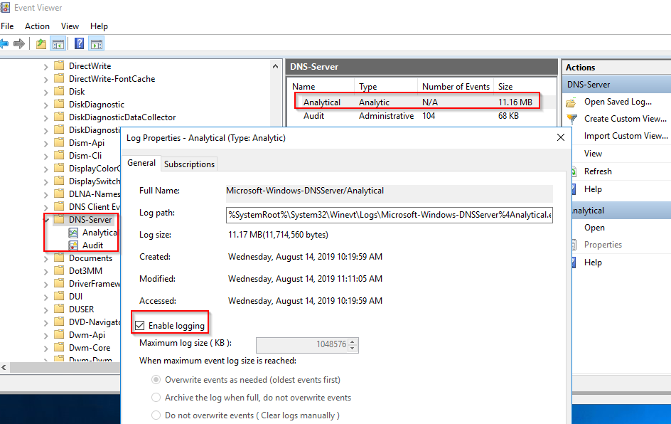

Analytical logs are considered Event Tracing for Windows logs and output to an “.etl” file. Unfortunately, with event viewer, analytical logs cannot be viewed while they are actively logging. We could view these logs live with Microsoft Message Analyzer <https://blogs.technet.microsoft.com/runcmd/viewing-analytic-logs-without-disabling-them/>. Normally, to send windows logs to the SIEM, we may use winlogbeat. At the time of this writing, winlogbeat does not support event tracing logs so, we’ll need another solution. A great tool called SilkETW <https://github.com/fireeye/SilkETW> can accomplish what we need.

For this research I utilized the HELK <https://github.com/Cyb3rWard0g/HELK> as my SIEM solution. Follow the instructions for install in the wiki. After completing the installation of HELK we need to do some preparation for the data coming from SilkETW. Here’s what our network looks like.

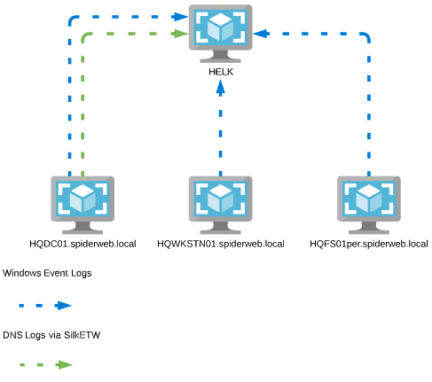

On our HELK instance, we’ll need to ensure that port 9200 is listening and mapped depending on which install was selected. If the DOCKER install was used, use “sudo docker ps” to see if port 9200 is mapped to 0.0.0.0 for the Elasticsearch docker container.

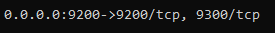

If this port is not listening, we’ll need to set that up. In your HELK/docker directory, open the helk-kibana-analysis-basic.yml file with an editor. Add the ports section as shown.

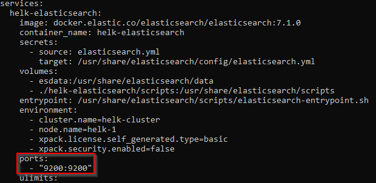

Save the file and close. Now, we can rebuild Elasticsearch. In your bash terminal execute the following:

export ADVERTISED_LISTENER=<your helk ip>  
 sudo -E docker-compose -f helk-kibana-analysis-basic.yml up — build –d

Once complete, re-run “sudo docker ps” to check your mapping.

Next, we need to create an index for our data coming from SilkETW. The data fields for DNS Analytical Logging can be found here <https://docs.microsoft.com/en-us/previous-versions/windows/it-pro/windows-server-2012-R2-and-2012/dn800669(v=ws.11)>

In the Kibana console, create a post request.

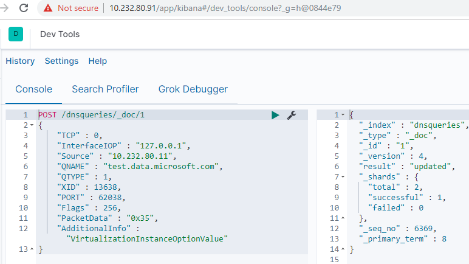

Now, we need to create the index pattern by navigating to the management portal.

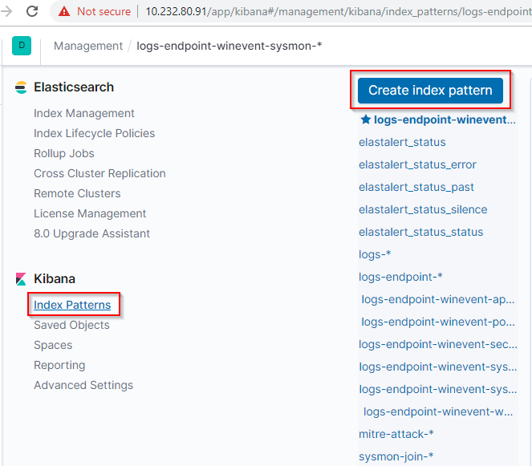

Enter “dnsqueries*” to find the new index and select the “Next step” button.

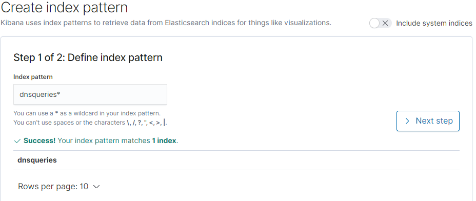

Select the Timestamp filter and finish by clicking “Create index pattern”.

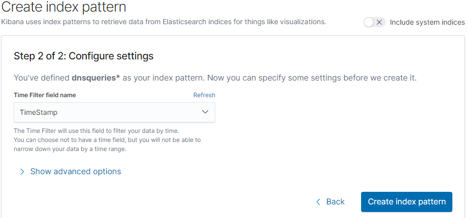

We should now be able to forward log data with SilkETW to our HELK instance. SilkETW requires the log GUID so that it knows where to pull from. I found this blog <https://blogs.technet.microsoft.com/teamdhcp/2015/11/23/network-forensics-with-windows-dns-analytical-logging/> post referencing this GUID {EB79061A-A566–4698–9119–3ED2807060E7}.

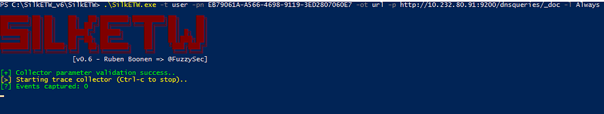

We can test that our logs are correctly being sent to HELK by performing a basic nslookup from another host on the network.

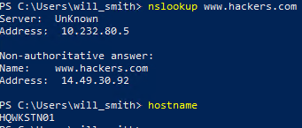

Now, from the discover panel in Kibana, we can search for that DNS lookup.

Using the search filter ‘XmlEventData.QNAME:”www.hackers.com"’, we can quickly find that specific lookup. Note the various fields and data within the _source field. We can identify that the query came from 10.232.80.11.

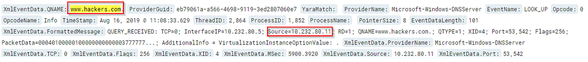

Great! So far, we’ve setup HELK, DNS Analytical Logging, created our index and index pattern, started SilkETW and successfully captured a DNS query. Now, how do we utilize this setup to deceive and detect threat-actors in our network?

**Canaries**

We’ll start by creating a canary computer object. In a live environment, you’ll want to get as detailed as possible with your canaries. Mimicking real settings of other objects and naming schemes in active directory as to not tip off the attacker of your ruse. In these examples, I use obvious names for teaching purposes.

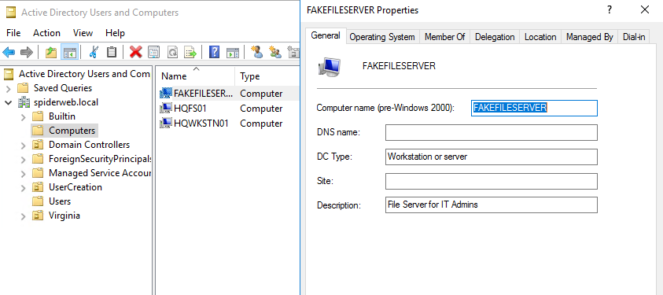

This computer object will mimic one of our file servers. For DNS to perform lookups and look as legitimate as possible, we’ll need to create a DNS entry for fakefileserver.spiderweb.local.

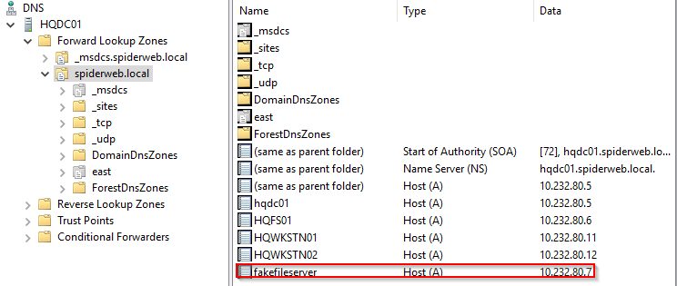

With our fake file server and DNS entry complete, we can create a canary user account as well. As with the other objects, be sure to set an enticing description, phone number, and so on, making the account seem as legitimate as possible.

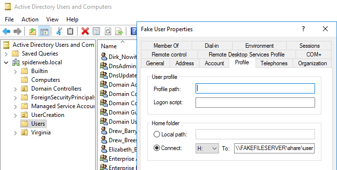

Importantly, you’ll want to point the user’s “home folder” to the fake file server. The share does not have to exist for the property to exist.

**PowerView Overview**

PowerView <https://github.com/PowerShellMafia/PowerSploit/blob/dev/Recon/PowerView.ps1> is a PowerShell script that aids active directory enumeration and exploitation. It has many built-in functions that allow us to enumerate users, groups, SPN’s, user sessions and much more. This tool may be executed either from disk or in-memory. It is also possible to execute through a variety of Remote Access Trojans (RATs).

Many functions within PowerView will attempt to interact with a remote host. One such function is the “Find-DomainUserLocation” function. This function attempts to find where specific users are located on the network by enumerating sessions. For reference, this technique maps to MITRE ATT&CK framework T1049 <https://attack.mitre.org/techniques/T1049/>. First, it queries active directory for all computer objects. It then queries each computer for active sessions and lists where each user’s session is coming from. If we provide the –stealth flag, PowerView will only enumerate sessions from file servers. This is a great way to find user locations within the network.

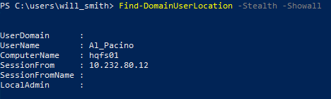

Here we see an example showing “Al_Pacino” has a session to the file server from 10.232.80.12.

**Enumeration Detection**

For Find-DominUserLocation –Stealth to work and check the sessions on each host, it needs know where the remote host is. When connecting to the remote host, a DNS query is performed. By itself, a DNS query to our HQFS01 isn’t abnormal but, a connection to our canary fake file server is. In this way, we can detect potential domain enumeration when fakefileserver.spiderweb.local is queried. The reason this works with the stealth flag, is that PowerView will look at each user account and enumerate the home directories, script paths, and profile paths. Those servers are considered high-traffic servers and will be scanned by default from the stealth flag. Our canary user has a home directory pointing to \\fakefileserver\share\users which causes Find-DomainUserLocation to attempt to gather sessions from it.

Now, let’s look at HELK after “Find-DomainUserLocation –Stealth –Showall” is executed.

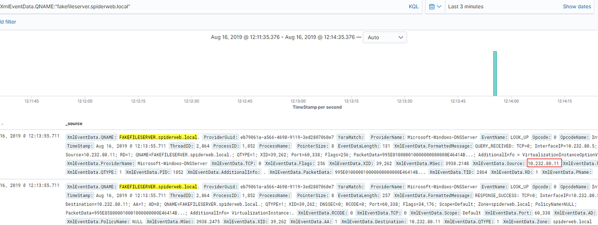

We see two events for fakefileserver when Find-DomainUserLocation queried for it. We can increase the fidelity of our detection a bit by either including more fake file servers.

**Enhancing detection with Sysmon and a fake SMB/SAMR server.**

We just covered performing deception and detection while logging at the server-level. Meaning, all our logging was performed by DNS Analytical Logging on the domain controller and forwarded to HELK with SilkETW. This setup works well but, we lose granularity with our data vs using a host-based solution.

You’ll need to setup Sysmon on your endpoints. First download Sysmon at <https://docs.microsoft.com/en-us/sysinternals/downloads/sysmon> and refer to <https://github.com/SwiftOnSecurity/sysmon-config> to install the z-AlphaVersion.xml configuration to enable DNS logging.

**Canary Setup**

In this scenario, we’ll have some additional parts to our setup.

We’ll start by creating a couple canary computer objects. In a live environment, you’ll want to get as detailed as possible with your canaries. Mimicking real settings of other objects and naming schemes in active directory as to not tip off the attacker of your ruse. In these examples, I an obvious name for teaching purposes.

FAKEFILESERVER will be a linux box running our modified “smbserver.py” program to respond to session enumeration.

We also need to make another computer object where we’ll have our modified “smbserver.ph” fake SAMR server responding to local administrators group enumeration. We’ll call this one “HQCITRIX01”.

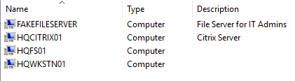

This computer object will mimic one of our file servers. For DNS to perform lookups and look as legitimate as possible, we’ll need to create DNS entries for fakefileserver.spiderweb.local and HQCITRIX01.spiderweb.local.

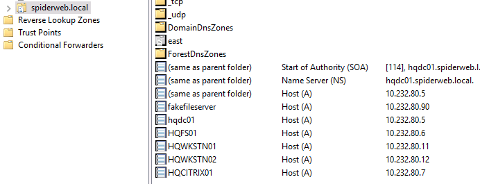

With our fake file server and DNS entry complete, we can create a canary user account as well. As with the other objects, be sure to set an enticing description, phone number, and so on, making the account seem as legitimate as possible.

Again, you’ll want to point the user’s “home folder” to the fake file server. The share does not have to exist for the property to exist.

**The Trap**

Our environment is setup so that if an attacker phishes an endpoint and begins enumerating sessions and local administrators on the network, they will be presented with an attack path of our choosing. Ideally, our fake SMB/SAMR server that responds to session and SAMR queries would also be sending alerts when queried.

On our canary hosts, we use a standard ubuntu server image, impacket, and our modified smbserver.py.

Clone impacket <https://github.com/SecureAuthCorp/impacket>

Clone <https://github.com/rvrsh3ll/CanaryServer>

Backup and replace “impacket/impacket/smbserver.py” with our modified version.

Run “pip install .” in impacket/ directory.

The modified version of impacket’s smbserver.py accepts two json files for data, session_data.json and samr_data.json.

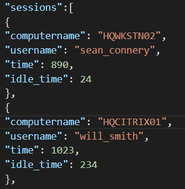

We’ll set several fake sessions on fakefileserver and have them point to various workstations. The user will_smith is a real member of the domain admins group and has a fake session coming from HQCITRIXSRV01.

Next, we’ll want to set fake SAMR data on HQCITRIX01.

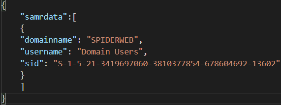

Save the json files in whatever directory you’re going to run smbserver.py from. I placed them in the impacket/ directory. Then, just start smbserver.py. I use “” as a share name. This has the effect of returning nothing when Get-NetShare is ran against it.

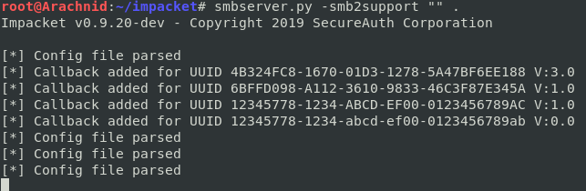

The Security Account Manager (SAM) Remote Protocol (Client-to-Server) provides management functionality for an account store or directory containing users and groups. <https://docs.microsoft.com/en-us/openspecs/windows_protocols/ms-samr/96952411-1d17-4fe4-879c-d5b48a264314>

Our smbserver.py will respond to SAMR enumeration requests for local administrators and in this case, tell the enumerator that “Domain Users” are part of the local administrator’s group on HQCITRIX01.

In addition to fake data, our environment also has Sysmon forwarding DNS lookups to our HELK instance. All these parts together provide an excellent scheme for detecting adversaries enumerating our network resources.

**The Attack**

In this scenario, our adversary has landed a phish on HQWKSTN01. They want to find out if they have an attack path to domain administrator. Either using manual enumeration with tools such as PowerView’s “Find-LocalAdminAccess” and “Get-NetSession” or using a tool such as BloodHound <https://github.com/BloodHoundAD/BloodHound> to graphically map this path. In our scenario, the attacker decides to run BloodHound which will enumerate the users in Active Directory and determine where high-trafficked servers such as file servers are by looking at user properties such as the home directory. It will then attempt to enumerate sessions on those servers. Bloodhound will also enumerate the computers in Active Directory and query the SAMR service to enumerate local administrators.

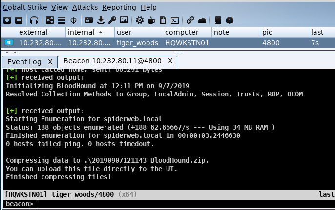

While bloodhound is querying for session and local administrator data, we can see the queries hit our fake server. This would be a great point for detection and alerting!

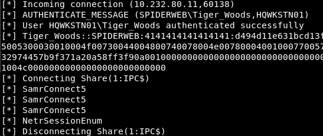

Here’s what the attack flow looks like for each query.

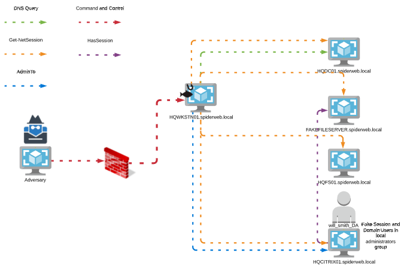

**Detection**

As we discussed previously, the DNS lookup of our canary computers should set off some alarm bells. Now, we are using Sysmon with DNS logging on each host instead of SilkETW forwarding DNS logs form the DC. This gives us more detail as we can see which processes are performing the lookup.

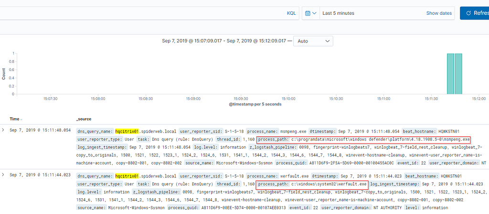

Here we see the field dns_query_name matches our canary server hostname “hqcitrix01.spiderweb.local”. Unlike DNS Transaction Logging and SilkETW, we see additional information about the query. Most notably, is the process_path field. We see two lookups for our canary. Curiously, the first lookup is from the msmpeng.exe process which is windows defender. Next, werfault.exe performs a DNS lookup, as that is the process that we have cobalt strike injecting into for post-exploitation action using execute-assembly in beacon.

**Conclusion**

The deception and detection techniques covered in this blog post are tool agnostic. Any queries for your canary file server should be investigated. This blog post covered detection by utilizing DNS Analytical Logs on the DNS server and forwarding those logs to a SIEM with SilkETW. I also covered how to utilize Sysmon, a fake SMB/SAMR server and HELK to fine-tune these canary DNS detections at the host-level. Happy hunting!
