### Getting Started With Azure DevOps

**Introduction**

Recently, I set out to find a simple solution to manage the building of all my offensive C# tools in a central location. The main goal I had for this project was to find a solution that didn’t require a ton of infrastructure to setup. I quickly came across the Azure DevOps platform. It didn’t take long for me to build a pipeline from my GitHub repository and compile my first binary.

This blog is intended to be a quick walk-through on how to setup your first C# build pipeline on Azure DevOps. In this tutorial, I am using the free tier. For more pricing options see <https://azure.microsoft.com/en-us/pricing/details/devops/azure-devops-services/>

**Building Your First Project**

Getting started is as easy as authenticating with your GitHub account. You don’t need a GitHub account though, as you may opt to store your code in an Azure repository. Once you’ve authenticated, click the “New project” button to create your first project.

Enter the details of your new project and select whether you want it public or private. You can still invite people to the project if it is private.

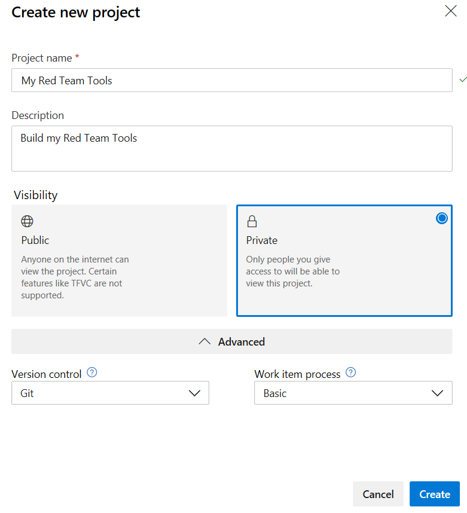

After you create your project, you’ll be presented with your overview page. On this page, you can link to a wiki or readme, display project stats and invite members to your team.

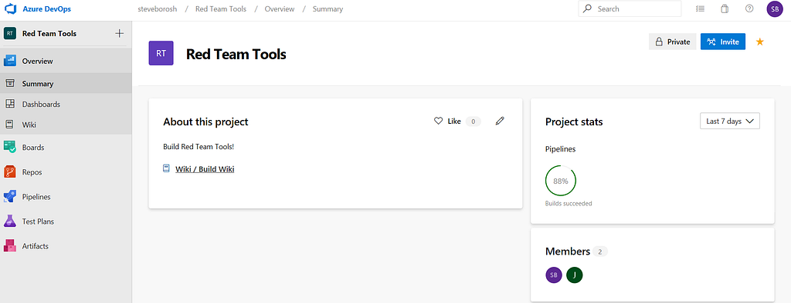

In the “About this project” section, you may use the pencil icon to edit details of the project.

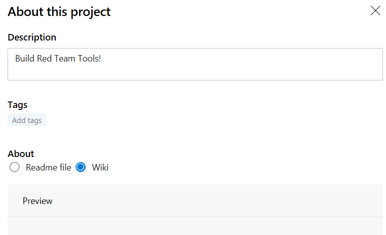

The “About” radio button choices must be present prior to editing the description. In my case, I created a simple wiki page.

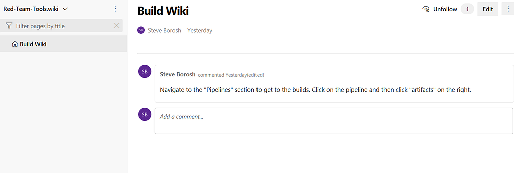

Now, you’re all set to start your first pipeline. Navigate to the pipeline section and click “New Pipeline”.

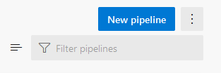

The next page is where you have the option of manually modifying your pipeline with YAML files. Or, you may choose the simple route and select “Use classic editor” at the bottom of the page. In my examples, I’ll be using the classic editor.

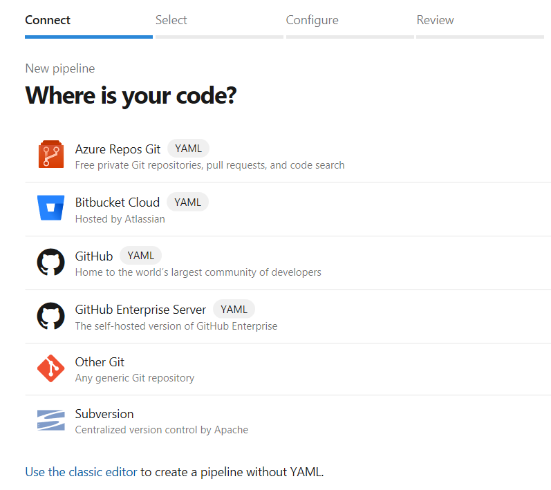

Now, you have the option to select where your code resides. In this instance, I’ll choose a GitHub repository from my account.

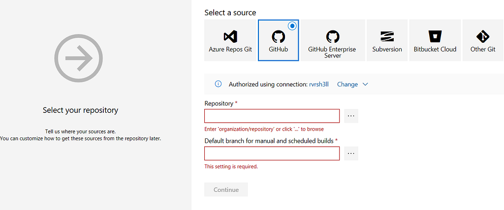

Simply search for and select the repository where the code is.

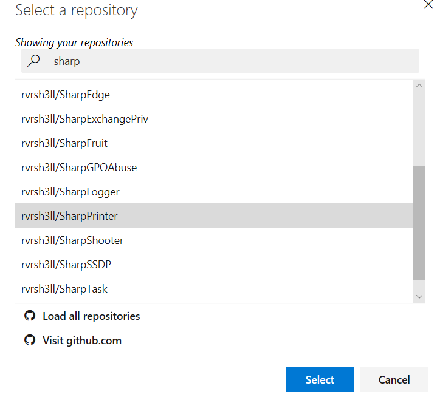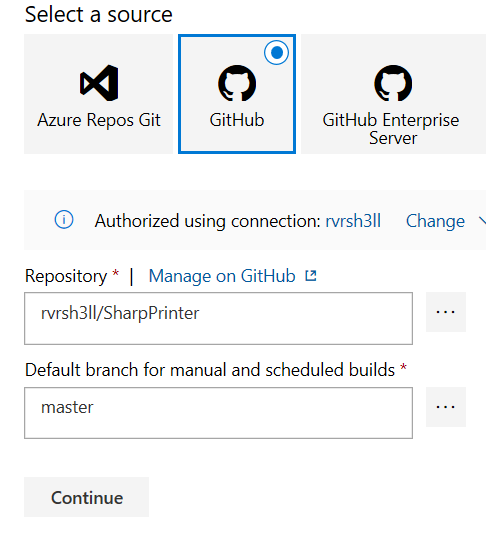

Next, select your template. I’m using the “.NET Desktop” template.

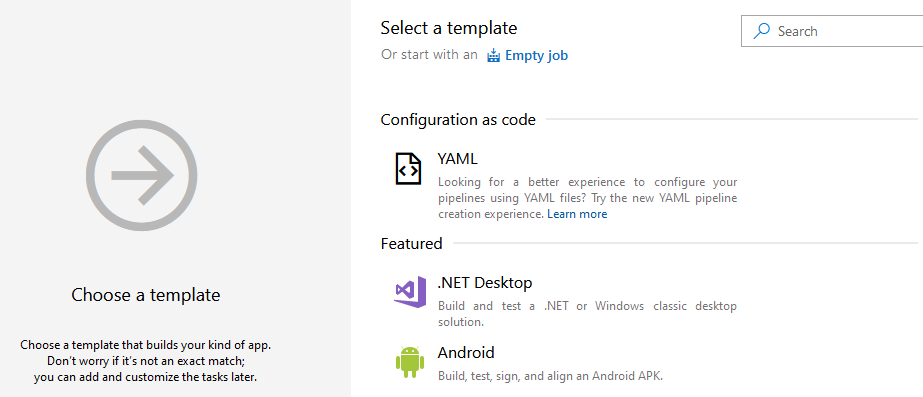

The nice part about the classic method is that it fills in the Agent tasks for you. However, it defaults to an Agent specification of Visual Studio 2017. You may want to change that to “windows-2019” on the right-hand side of the menu. Select “Save & Queue” to save your settings and begin the build process.

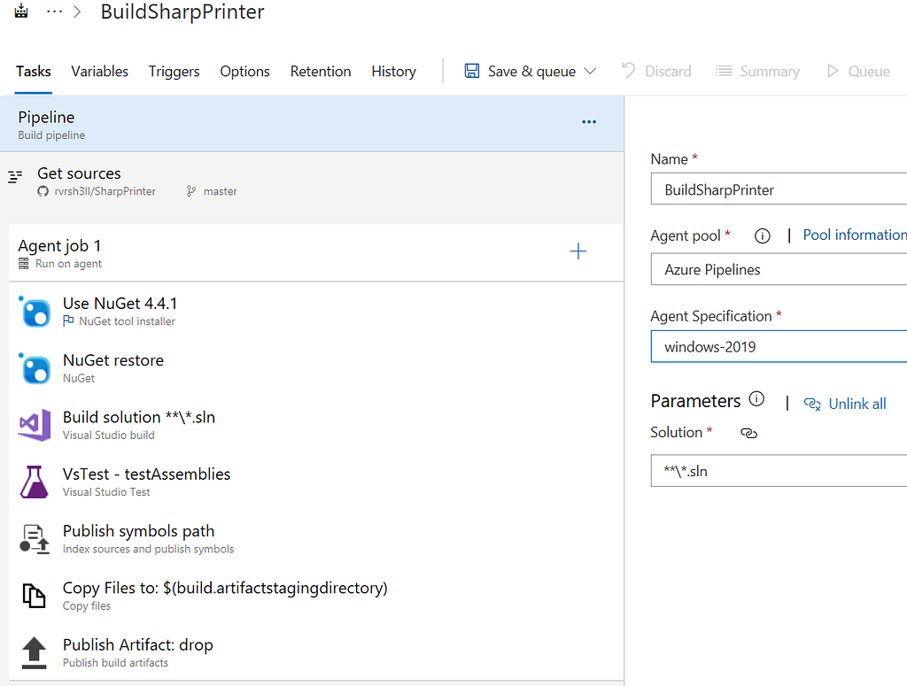

If you want your builds to execute anytime a change is committed to the selected branch, select the “Triggers” tab and check the “Enable continuous integration” box.

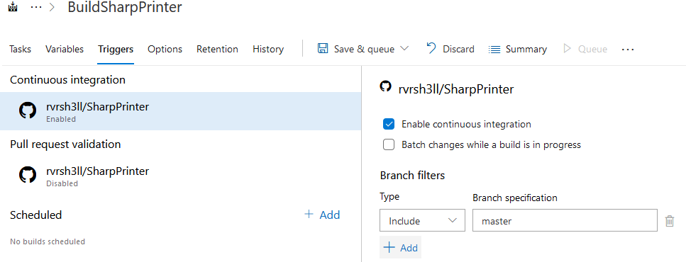

After saving, you’ll receive one final prompt before building. Review your settings, add a save comment and then click “save and run”.

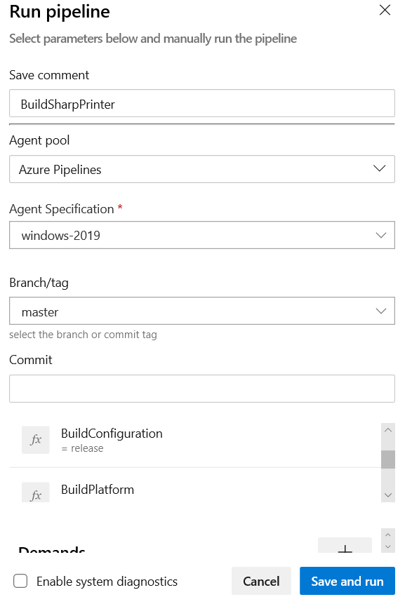

Your Pipeline will display a blue spinning circle as the agent queues and runs the job. If it fails, you’ll see a red “x”. When it succeeds, a green check mark will appear. Click on the build to see the results.

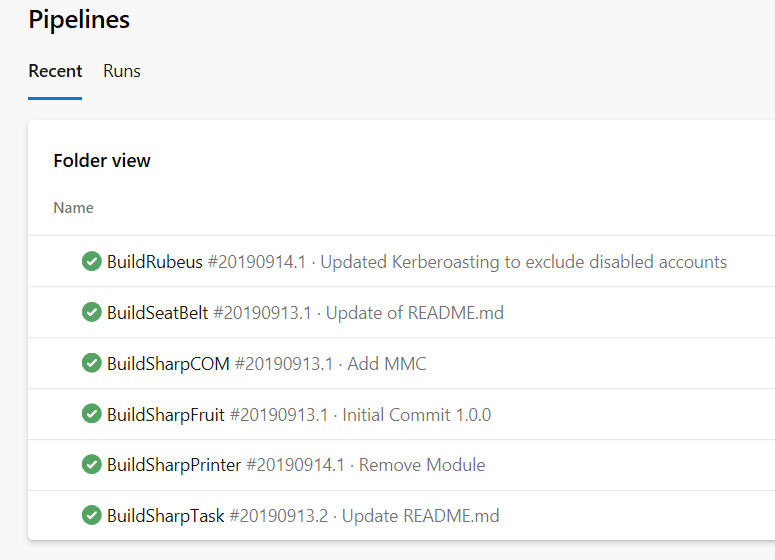

Here we see that our build completed in 54 seconds and 1 artifact was created. Artifacts are your completed project builds. Click on the “published” link.

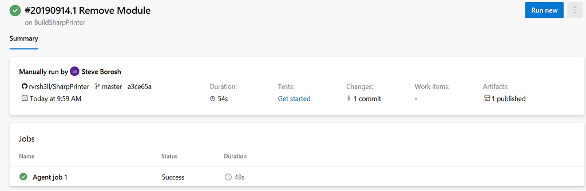

Select each drop-down until you reach your compiled binary as shown.

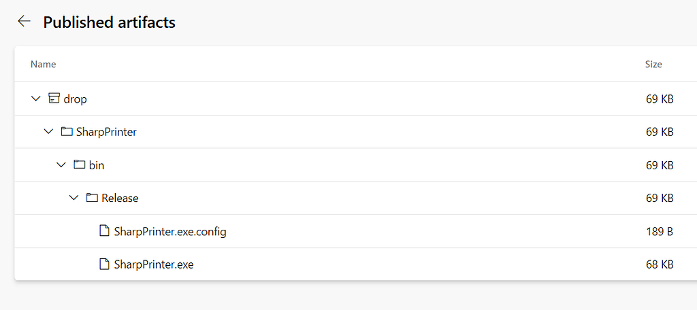

You may click the binary and choose to download it to your local system. I am not currently aware of a method to select all pipelines and download every binary in one package using the free tier of the Azure DevOps service.

**Conclusion**

In this blog post, I covered the basics of using Azure DevOps pipelines to build your .NET tools in a central location. The ability to invite people to your projects is a great way to easily share builds within your team. The ability to collaborate, test, perform continuous integration and build your tools in one easy-to-use platform makes Azure DevOps a great option to try.
