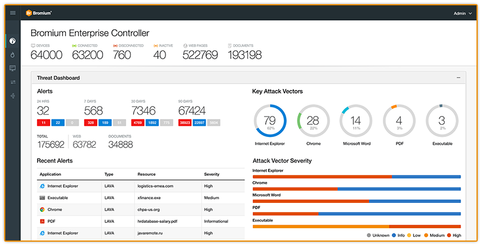

The purpose of this post is to re-iterate that no single solution should be relied upon as a one-stop solution against all attackers. I respect the advances Bromium has made in security however, a defense-in-depth approach should always be taken regarding enterprise security.

Note: This information represents a snapshot in time. The Bromium suite has “hopefully” remediated these issues.

This blog post covers an assessment against a network utilizing the [Bromium](https://www.bromium.com/) Endpoint Protection suite. If you’re not familiar with Bromium, there’s a good whitepaper [HERE](https://www.bromium.com/sites/default/files/Bromium-Whitepaper-vSentry.pdf). For now, what you need to know is that it’s an antivirus/antimalware suite that takes it a step further and opens “most” executable’s, office documents and browsers inside micro-VM spaces to “prevent” exploitation to the host machine.

I identified that the organization was using Bromium by enumerating LinkedIn profiles. I first decided to use a custom (HTML Application) HTA. While Cobalt Strike has the ability to generate HTA’s directly, I wanted to make sure that mine executed a fully-staged payload and would get past any proxies or internal filters. I generated a fully-staged PowerShell payload in Cobalt Strike and hosted it on a team server so that it was available to the Internet. A fellow co-worker and I came up with an HTA profile that would include all of the information needed to get through most internal filters and proxies. You may find the code [HERE](https://github.com/rvrsh3ll/PenTesting-Scripts/blob/master/ProxyAware-ps-Stager.hta).

After sending the phishing email, about 30 minutes passed and I noticed the Cobalt Strike web log was receiving hits to the fully-staged PowerShell payload and shortly after, I had beacons calling back. Success! I’ve successfully phished a Bromium protected endpoint by utilizing the HTA executable.

Next, I performed my usual enumeration steps, checking what is my current access level, and what is the host connected to on the network. After a quick “netstat –an |findstr “EST” in the established Beacon, I noticed every host was connected to port 80 on one specific server. I set one beacon to sleep at 0 seconds and started a [SOCKS](https://www.cobaltstrike.com/help-socks-proxy-pivoting) tunnel. After directing my browser through the proxy to the target host on port 80, we were greeted with the login page for the “Bromium Enterprise Controller”.

Most of you know what’s going to happen next. Yes, the login was admin:admin and I was logged in as the administratos of the entire infrastructure’s Bromium management console. From here I could monitor the blue team’s actions, what payloads of mine may be being flagged and even stop Bromium vSentry on any host in the organization. I immediately noticed that the blue team had flagged my “HTA” as an executable document and successfully burned that payload for any future phishing campaigns. Knowing that the blue team was quick to react to our phishing campaigns and block payloads, I decided to exercise them with one more phishing campaign and a new payload.

This time I decided to utilize a Microsoft Compile HTML (CHM) payload. These files are executable and pop little help screens. Creating one requires installation of “HTML Help Workshop”. There is a great script that is part of the Nishang framework for compiling these quickly [HERE](https://github.com/samratashok/nishang/blob/master/Client/Out-CHM.ps1). My phishing ruse this time was to be a “Phishing Alert: Corrective action required” email. My payload was disguised as a Bromium update package and the email was spoofed to come from the lead security official within the organization. Again I hosted the .chm file in Cobalt Strike for a web delivery. One important thing to note with sending out CHM files this way. When the user downloads the file, they have to right-click the .chm file, select properties and check the “unblock” box. What? Who would go through all that trouble? Well, after sending a few more emails I was greeted with more beacons! Remember, with the proper ruse, people will do what you ask them to do.

That’s the conclusion of my story about phishing against Bromium. I was able to successfully bypass the seemingly default settings of Bromium to gain a foothold on my target domain. Defenders, don’t rely on a single solution to block everything. It only takes hackers one time to be right. I hope this story helps others exercise their client’s defenses and everyone learns some valuable lessons.
